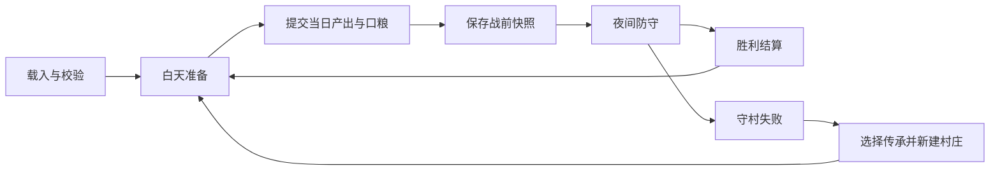

# 代代守村：游戏设计

2026-11-13 最新表现决定：取消实时 3D 和 3D 转二维方案，恢复原二维图集、人物与十类怪物序列帧、Laya 部件建筑及二维粒子。保留高清矢量面板、按钮和 UI 图标，人物头像恢复原帧。继续使用 base、characters、battle 三包，不修改经营、繁衍、战斗、排行榜及存档规则。保留大王之心鲜红按钮环绕、精英圈与四类命中效果，不恢复攻击拖尾及建筑升级粒子。回退实施边界与待验证项见 [31 恢复二维场景与序列帧](../tech/31_恢复二维场景与序列帧.md)；[30](../tech/30_全场景3D与高清UI.md) 为停止采用的历史试验，历史包体和验证结果不代表本轮完成状态。

2026-11-12 组合怪物更新：当前配置为13。共5小怪＋5首领，局部染色与兼容配件组合，外观种子固定且不影响繁衍随机；每12夜依次轮换五类首领。地图/UI在主包，人物在主场景出现后准备，怪物在点击守夜时准备，失败可手动重试。完整规则与验证见 [28](../tech/28_组合怪物与分阶段资源加载.md)。以下各日期记录保留历史含义。

2026-11-11 全面屏更新：体验版本 1.0.4 改为固定 720 宽、动态窗口高度；顶部避开状态栏与微信胶囊，底部按钮避开手势区，新增空间主要用于村庄。成人显示 64～68，城门只显示顶部数值与血条。业务与存档配置仍为 10，详见 [19 全面屏与安全区适配](../tech/19_全面屏与安全区适配.md)。

2026-11-12 早期更新：当时配置为11。纯净开始只保留最高纪录，清除旧村庄、家谱、珍藏与传承；场景、音频与图文排版见 [22](../tech/22_场景音频与图文排版交付.md)。每天进入后确认领取 20 粮，按本地自然日、仓储截断、同村同日重进不重复，每次新开村可重新领一次；满仓实际到账 0 也记为已领。家庭改为状态卡与明确动作；资源栏统一单行“粮 80/200、木 60/200、人 6/8”。无栏农田、村庄站位、塔朝向、动画对齐与资源取舍详见 [18 村庄视觉与每日口粮](../tech/18_村庄视觉与每日口粮.md)。

2026-11-11 条件与说明更新：当时配置版本为 9。灰色入口显示具体缺口与处理办法；小记新增“玩法说明”，按起步、村民、家庭、建设、守夜五章滑动阅读；资源栏补“粮、木、人”。警钟保持攻速 +50%、每夜一次，持续改为 15 个战斗秒，新增倒计时和金色脉冲。规则、实现与本轮验证见 [17 条件提示与玩法说明](../tech/17_条件提示与玩法说明.md)。

2026-11-11 自动驻塔更新：当时配置版本为 8。已建塔自动补入仍在劳作期的成年人，保留已有驻守；玩家可以换人，选中其他塔的驻守者时两人对调，不再提供主动释放驻守的操作。规则、接班时机和验证见 [16 防塔自动驻守](../tech/16_防塔自动驻守.md)。

2026-11-11 持续成长更新：此前配置版本为 7。建筑、仓储、城门与敌人采用持续成长公式；新增性别偏置和断档旅人、3 倍速、原创小音乐、篝火集合与头顶表情。当前规则及验证以 [12 持续成长与村庄生活](../tech/12_持续成长与村庄生活.md) 为准，UI 与代码清理、随机抽取修复见 [13](../tech/13_UI精修与代码审查.md)，塔位覆盖与表情距离见 [14](../tech/14_塔位覆盖与表情距离.md)；本文旧版固定三级、固定 200 上限及历史体积不再代表当前版本。

2026-11-11 更新：单局最高成功防守波数好友榜、5% 精英村民及放大成家红心已实现。普通寿命 12/3 夜，精英 18/5 夜，配置版本 4；实现、资源源文件和验证边界见 [10 好友榜与精英村民](../tech/10_好友榜与精英村民.md)。下文历史测试及包体数字保留对应轮次含义。

版本：v0.2。日期：2026-11-10。状态：已按用户授权形成微信可玩首版，并同步晚年生活、滑动列表及存档决策；数值尚未完成真实多代调平。

用户已确认的约束见 [文档索引](README.md)。本文保留早期数值提案，已实施范围以 [首版运行记录](../tech/04_首版实现与运行.md) 为准；养老三夜、每夜两粮、开发人工清档等已确认规则见 [08](../tech/08_晚年生活与滑动列表.md)。早期关键选择集中列于 [开发计划与验收](03_开发计划与验收.md#待确认决策)。

## 1. 产品定位

一句话：白天安排村民生产与养育，夜晚派成年人守塔，让下一代接过守护村庄的责任。

类型组合：轻经营、家庭传承、自动战斗塔防。目标体验是看得懂、单手操作、随时退出，兼具养成感和短周期决策。

### 1.1 玩家应当获得的三个体验

1. 看见自己安排的家庭诞生孩子，孩子继承天赋，成年后真正帮助村庄。
2. 在养育未来人口与保障当下防线之间取舍，而不是无限点击收菜。
3. 同一座村庄经历多个年份；建筑持续提效，并通过接班、季节、兵种和短期村规形成选择。

### 1.2 方案选择

| 方案 | 优点 | 代价 | 本稿选择 |
| --- | --- | --- | --- |
| 固定村庄、持续接班 | 一屏清楚、情感连续、资源复用，契合小包体 | 后期变化主要依赖组合与人口更替 | 采用 |
| 每局迁徙并重建村庄 | 每局重新布局，变化强 | 更重视重开，弱化长期养村感 | 不作为首版主循环 |
| 自由扩张大地图 | 建设空间大 | 资源、交互和寻路成本增加 | 不进入首版 |

采用已有 Laya 工程作为拟实施载体，技术可行性先通过最小微信发布包测量确认。

### 1.3 首版范围

| 内容 | 建议规模 |
| --- | --- |
| 地图 | 1 张固定道路、固定塔位的竖屏地图 |
| 建筑类型 | 民居、农田、伐木点、箭塔、投石塔、减速塔，共 6 类 |
| 固定设施 | 村门、中心炉火；村门可持续加固 |
| 村民 | 最多 20 人，包含孩子与成人 |
| 防御塔 | 4 个塔位，3 类塔，等级可持续提升 |
| 敌人 | 5 类基础行为，复用有限外观与序列帧 |
| 人物标签 | 8 项先天天赋、6 项成年专长，每人各 1 项 |
| 村规 | 12 项，每次选 1 项，持续 3 夜 |
| 季节 | 4 季，每季 3 夜 |
| 存档 | 一份当前村庄、一份有限传承资料，双槽轮换保存 |

当前不包含联网对战、云存档、广告复活、付费道具、体力、实时离线收益、装备掉落、自由道路编辑或永久科技树。后续需要这些能力时另开范围评审。

## 2. 基本操作与节奏

### 2.1 目标节奏

- 白天准备不设倒计时，常见操作目标为 20～40 秒。
- 夜晚战斗目标为 30～45 秒；它是调平目标，不是超时失败条件。
- 夜晚允许 1 倍、2 倍、3 倍速和主动暂停。
- 一次打开可以只玩几个昼夜，也可以持续经营同一村庄。
- 前 5 分钟目标：至少完成一次出生、成年、选择专长和驻塔接班。

### 2.2 操作约束

- 点选建筑、村民或塔，再用底部面板选择操作；不用拖拽精确落点。
- 白天岗位与夜间驻塔分别保存，白天种田的人可以夜晚守塔。
- 每人最多占用 1 个白天岗位、1 个夜间塔位。
- 已建塔按塔位顺序自动补入未驻塔的劳作成人，保留已有驻守与白天岗位；人数不足才留空。玩家选中其他塔的驻守者时，两塔人员对调，不提供主动释放驻守。
- 夜间可暂停后调整驻塔人选；调整保留各塔当前冷却和增减益剩余时间，不能靠换人反复获得立即攻击。
- 建造、升级、改建、修门、成家、生育、接纳旅人只在白天执行。
- 进入后台立即暂停；返回后由玩家点击继续，游戏时间不追赶后台停留时长。

## 3. 阶段与唯一结算顺序

本节是后续技术实现与测试的共同依据。阶段标识是拟新增业务枚举，不是现有工程接口。

暂停、遮罩弹窗和保存错误是附加状态，不替代白天、夜晚等主阶段，避免恢复时丢失原阶段。

### 3.1 白天准备：DAY

进入可操作的白天前，先完成清晨待选择事项，再确定当夜波次与预告。旅人、村规候选等结果在清晨生成并保存，反复打开界面不能重新抽取。难度从第一年起固定为最高3档，跨年不再出现选档。

玩家可以安排岗位、建造、修门、成家和迎接孩子。每个确认操作均先校验，再将资源扣除、人口变化和随机状态作为一个整体保存。保存并读回确认后才显示操作完成。只要尝试过写入但结果尚无法确认，就冻结其他进度操作，核对或重试同一份候选结果，不能承诺存储已经回滚。

详细稿明确细化早期概念：生育在白天点击确认时立即完成并存档；开始守夜不再重复执行出生。这样新生反馈发生在准备阶段，不打断战斗切换。

### 3.2 从白天进入夜晚：PREPARE_NIGHT

顺序固定为 R01～R07：

1. R01：先为已建空塔自动补入可用劳作成人，再锁定当日白天岗位、已照料孩子名单、劳作成人名单、已有老人名单和夜间分配；校验不存在重复岗位或不存在的人物。
2. R02：计算当日产粮、产木、口粮以及即将溢出的仓储；预览与最终计算使用相同规则。
3. R03：粮食先加产出，再扣当日口粮，最后按仓储上限截断；木材加产出后按上限截断。
4. R04：若口粮不足，将粮食记为 0，并把当夜缺粮减益写入战前状态；不产生负库存。
5. R05：锁定当夜波次和战斗随机状态，生成夜晚运行初始状态；不增加年龄，不减少剩余成年夜数。
6. R06：保存包含 R01～R05 结果的完整战前快照，确认可读回后进入战斗。
7. R07：若保存结果未确认，冻结在准备界面并提示核对或重试同一提交；不扣第二次资源、不启动敌人。若重启后发现该完整快照已有效写入，则承认它已经完成，按战前快照恢复。

当晚缺粮减益属于明确的玩法建议：所有有人操作的塔攻速乘 0.70，仅持续该夜；不降低生命，不使村民死亡。下一夜重新按口粮计算。

没有成年村民或没有照料者时仍允许开始守夜，并明确预警；不能把校验写成无法推进也无法结束本村的死锁。

### 3.3 夜间战斗：NIGHT

- 有驻塔成人的塔自动攻击；劳作成人不足时部分已建塔无人驻守，这些塔不攻击。
- 敌人到达村门后扣门血并退出战斗；不逐个击杀村民。
- 当计划队列为空、敌人全部消失且首领召唤额度已关闭时判定胜利。
- 村门生命小于等于 0 时立即失败；同一逻辑步同时出现敌人清空与门血归零，以失败为先。
- 警钟每夜 1 次，使已驻人塔攻速乘 1.50，持续 15 个战斗秒（3 倍速约 5 现实秒，暂停停止计时）；不恢复门血或增加库存。
- 夜间不结算生产、生育、成年或退休。

### 3.4 守住后的结算：DAWN

按 R08～R15 执行一次，完成后统一保存，再播放表现：

1. R08：保留本夜结束时的村门生命，不自动回满；清除敌人、临时减速、当夜缺粮减益、旧波次与旧战前运行信息。
2. R09：先将战前已有老人的晚年夜数减 1；仅对战前劳作成人的剩余任职夜数减 1。本次新成年与新荣休者不进入相应旧快照。
3. R10：战前已经出生、被安排照料的孩子成长进度加 1；未照料孩子保持原进度，不消失。
4. R11：成长达到 2 的孩子转为成人，设置 12 个成年夜数，生成固定的 3 项专长候选；新成人先完成专长选择，再自动安排生产空岗；成年后已可自动补入空塔，不需要额外选择驻守。同时解除照料岗位，原照料者参与自动填空岗，不恢复其更早的岗位。
5. R12：劳作夜数归零者荣休，释放岗位、照料和塔位，设置普通 3 夜、精英 5 夜养老，继续占人口并保留夫妻/亲缘。退休释放的塔位由其他可用劳作成人自动补上；已有老人晚年归零时寿终离村，释放人口与家庭、清理在场祖先引用并进入有界家谱。荣休计数只增加一次，寿终不重复计数。
6. R13：将当天记为已完成，天数加 1，计算下一天季节，并生成旅人、村规候选；此时不生成下一夜波次。
7. R14：以 DAWN 阶段一次保存完整胜利结果和待选队列。保存结果未确认时停在结算等待态，核对或重试同一结果，不重新增加年龄或发放进度。
8. R15：按“成年专长、旅人、村规”顺序处理队列，每个选择保存后移除一项。队列全部完成后，才根据固定最高档和已保存随机状态生成当夜波次与预告，一次保存为 DAY；没有待选项时直接执行这一步。队列未完成前不能进行普通白天经营或开始下一夜。生成后未确认保存时仍核对同一结果，不能重新抽波次。

当天出生的孩子若获得照料并成功守夜，当夜计入第 1 次成长；再守住一夜即可成年。新成年者从下一夜开始参与防守和成年倒计时。

### 3.5 守村失败：GAME_OVER

失败不推进年龄、不计入成功守住天数。保存失败结果、有限家谱和图鉴后展示：本次守住天数、出生人数、退休人数和新发现天赋。

玩家可选一项已发现先天天赋，赋给新村指定的一名初始成人；不叠加永久伤害、资源或人口。选择传承并确认重开后才替换当前村庄。主动重开也需要确认，不能用设置按钮立即清档。

## 4. 开局与数值总表

全部数值为 P2/P3 原型调平起点，来源是本设计假设，不是历史运营数据。

| 项目 | 建议值 | 调整影响 |
| --- | ---: | --- |
| 初始成人 | 6 人，3 男、3 女 | 开局生产、照料与守塔能力 |
| 初始剩余成年夜数 | 4、6、8、10、12、12 | 错峰退休，最早接班压力 |
| 初始家庭 | 预先组成 1 对可生育家庭 | 缩短首次理解路径 |
| 初始民居 | 2 间，每间提供 4 人容量 | 初始容量 8 人 |
| 民居上限 | 5 间 | 总人口上限 20 人 |
| 初始粮食 / 木材 | 60 / 60 | 初次生育与首轮升级选择 |
| 粮食 / 木材仓储上限 | 初始各 200，民居修缮每阶各 +160 | 与长期升级成本配套 |
| 劳作成人 / 孩子日口粮 | 2 / 1 | 人口结构与粮食压力 |
| 晚年时长 / 老人口粮 | 3 个成功守夜夜晚 / 普通 2 粮，节俭 1 粮 | 用户确认；继续占住房，冬季与村规沿用总口粮规则 |
| 每次生育粮食 | 20 | 即时成本，确认时扣除 |
| 孩子成长要求 | 2 个被照料且胜利的夜晚 | 首次接班速度 |
| 新成年人任职时长 | 12 个成功守夜 | 后续换代节奏 |
| 同户生育间隔 | 4 个成功守夜 | 避免短期刷同一家庭 |
| 旅人到访 | 正常第 5、9、13 天等；成年性别断档时可提前 | 所有来访统一至少间隔 3 个成功守夜，谢绝也记冷却 |
| 村门生命 | 初始 200，后续按 P(L) 成长 | 升级保留旧伤，只补新增上限 |
| 修门 | 成本 10 + 5(L-1) 木，恢复最大耐久 20% | 应用原修门村规，满血不可买 |
| 初始防线 | 1 级箭塔、1 级投石塔各 1 座 | 首夜无需先完成建塔 |
| 季节长度 / 年份长度 | 3 夜 / 12 夜 | 经营和战斗组合切换 |
| 挑战档 | 0～3，首局从 0 开始 | 有限难度档，不无限膨胀 |

初始人物的名字、头像、天赋和已具备的成年专长由固定开局配置提供；不通过重新开局反复抽取优劣开局。传承只替换约定的一名初始成人的先天天赋。

## 5. 经济、建筑和岗位

### 5.1 建筑与成本

升级统一扣木材和粮食，L 为当前等级，n=L-1，P(L)=1+0.45n+0.05n²。生产岗位前三阶解锁后封顶，后续继续提升单人产出；详见 [成长公式与调平](../tech/12_持续成长与村庄生活.md#4-持续成长数值)。

| 建筑 / 操作 | 初始状态 | 上限与收益 | 木材成本 |
| --- | --- | --- | ---: |
| 民居 | 2 间 | 最多 5 间，每间增加 4 人容量 | 新建 30 |
| 农田 | 1 处，1 级 | 岗位最多 6，每阶单人产粮 +2 | 木 40+25n，另扣粮 15+10n |
| 伐木点 | 1 处，1 级 | 岗位最多 4，每阶单人产木 +2 | 木 35+25n，另扣粮 15+10n |
| 箭塔 | 开局 1 座 | 固定塔位，持续升级 | 新建 30 |
| 投石塔 | 开局 1 座 | 固定塔位，持续升级 | 新建 45 |
| 减速塔 | 开局没有 | 固定塔位，持续升级 | 新建 35 |
| 任意塔升级 | 1 级 | 伤害乘 P(L)，保留类型和驻塔人 | 木 35+25n，另扣粮 10+10n |
| 任意塔改建 | 仅白天 | 花费后改变类型，保留等级 | 每次 20 |

初版不支持拆房或卖建筑，避免人口容量倒退和退费循环。改建前展示新类型、等级、属性与费用，玩家确认后扣除；没有暗中退款。

### 5.2 白天岗位

| 岗位 | 基础产出 | 限制 |
| --- | --- | --- |
| 农民 | 每人 8+2(L-1) 粮 / 天 | 受农田岗位数限制 |
| 伐木者 | 每人 6+2(L-1) 木 / 天 | 受伐木点岗位数限制 |
| 照料者 | 通常不产资源，使 1 名孩子获得成长资格 | 每位成人只照料 1 名孩子 |
| 待安排状态 | 无产出 | 无空岗时的状态，无主动按钮；仍消耗口粮，夜间可以驻塔 |

用户最终确认：待安排成人先按农艺/伐木专长填对应空岗，其余先农田再伐木，各轮按在村顺序。已有岗位不自动顶替，照料仍手选；满岗可直接选择换人。新来、成年选完专长、照料结束和增加岗位时自动补位，无空岗则保留待安排。

资源按游戏日结算，准备界面停留不会增加产出。满人口不增加生产岗位，超出岗位需求的成人仍要吃粮。

### 5.3 计算顺序与示例

单人资源产出：向下取整“基础产出 ×（1＋适用先天天赋加成＋适用专长加成＋季节加成＋村规加成）”。照料专长与村规的固定粮食产出单独累加。

当日口粮：先合计每人的基础口粮，应用节俭天赋，再乘季节和村规的加算系数，最后对总量向上取整。孩子最低基础口粮为 1，节俭天赋在成年后才将其成人口粮从 2 改为 1。

举例，不计加成时：2 名农民产出 16 粮；6 名成人和 1 名孩子消耗 13 粮，当日净余 3 粮。迎接孩子的 20 粮已经在白天确认生育时扣过，日结不再扣一次。

仓储示例：原有 195 粮，产出 16，口粮 13，最终存量为 198，不先把 211 截为 200 再扣粮。木材无日常口粮，按加产出后截断处理。

修门只能在白天执行。恢复当前最大耐久的 20%，应用修门村规、向上取整并截在缺失生命以内；成本 10+5(L-1) 木。满血时禁用并说明，无资源扣除。民居修缮升级另花木 30+25n、粮 10+10n，城门加固同成本；民居修缮不增加人口容量。

## 6. 人口、家庭与世代传承

### 6.1 成家条件

本稿建议：一男一女两名劳作期成年人，双方当前无配偶，且不存在下述亲缘关系，可以成家。该性别规则属于待确认的产品选择，不从用户的“人类繁衍”要求自动推导为已批准条件。

家庭不占独立房间编号；民居提供全村共享容量。成家本身不扣资源。仍需同时满足人口余量、粮食、家庭生育间隔和照料条件才能迎接孩子。

禁止组合：自己与自己、任何在场直系祖先与后代、共享任一父母的兄弟姐妹。初版不继续模拟堂表亲等更远亲缘。

### 6.2 生育确认条件

1. 双方仍在场、成年且处于同一有效家庭，双方剩余成年夜数都至少为 3。
2. 人口小于当前住房容量，且没有达到 20 人上限。
3. 当前库存足以支付生育粮食；不能预支当天尚未结算的产粮。
4. 该家庭没有尚未成年的孩子；如果以前生育过，距离上次出生已成功守住至少 4 夜。首次生育不要求先等待 4 夜。
5. 玩家为孩子指定一名劳作期照料成人，可由父母或其他劳作成人承担；照料会替代该成人原来的白天岗位，并在确认前说明。

家庭页顶部提供“安排村民成家”，下方按户显示父母头像与姓名、孩子成长和照料者。每户右下有独立“迎接孩子”按钮；条件不足时按钮灰色不可点，卡片直接显示首个阻塞原因，人物身份仍清晰可读。可用按钮进入“选择孩子的照料者”，明确选择会消耗 20 粮并调离原生产岗位；具体人选和最终提交均再次校验。

确认成功后，一次完成扣粮、生成孩子、分配照料、更新家庭间隔、推进家庭随机状态和保存。未确认保存前不展示“出生成功”；写入后读取暂时失败，不代表孩子一定没有写入。此时冻结进度操作，重试核对同一孩子与同一次扣粮；重新启动以实际读到的有效提交为准。

新生儿性别按在村孩子与劳作成人的性别比例温和偏向少数方，男性概率为 50%+25%×(女-男)/(女+男)，无可统计人口时为 50%；使用完整 uint32 阈值抽样，不固定交替。先天天赋从父母的两项中等概率继承，若相同则直接继承同一项。根据后续明确的序列帧要求，首版成年男女各一种外观，均有耕作、伐木、照料和方向行走；婴儿、男孩、女孩保留成长区分，出生时不额外生成或下载贴图。实际动作覆盖见 [图片与序列帧规范](../tech/02_图片与序列帧资源规范.md)。

当前成人、儿童和老人采用一致的性别辨识方向：男性冷蓝色、短发，女性暖橘色、长辫或发髻；儿童身形更小，老人白发并延续冷暖色。动作、导航、成长和岗位规则不因重画改变。

新生儿和旅人中的精英使用 12 个男女共用的专属姓名：旭勇、智卓、二百、翟毅、周博、赵靓、龙龙、昭易、明波、宋磊、徐超、四辈儿。普通孩子沿用“小＋字根＋编号”，普通旅人沿用行舟、云溪、山青、晚晴；移除普通专属姓名配置，不再生成“芊芊”。姓名调整不增加人口，不改六位开村人或既有村民。

### 6.3 养育和成年

获得照料并守住一夜，成长进度加 1；达到 2 后成年。幼儿消耗口粮，不参加生产或守塔。

如果玩家随后撤走照料者，该夜孩子不成长，但仍吃口粮；界面明确显示“本夜无人照料，成长暂停”。不新增随机死亡，也不默默补一名照料者。

成年时从 6 项专长中等概率、不重复地抽出 3 项供选 1 项。候选列表保存到存档，退出重开不重抽。原照料者释放后自动补生产空岗，下一天不再为这个已成年的孩子产出育幼粮。新成人选择专长后自动补生产空岗；成年后即可自动补空塔。玩家可手动调岗与更换夜间驻塔人选。

### 6.4 荣休、养老与寿终

- 普通新成人拥有 12 夜劳作期，精英为 18 夜，六名开村人仍为 4、6、8、10、12、12 夜；成功守夜才递减，余 2 夜起显示“即将荣休”。
- 劳作归零后立即变为对应性别的白发老人，在村内慢走和驻足，保留原姓名、家庭与亲缘。释放工作、照料与塔位，不再参与工作、成家、生育或驻塔。
- 普通养老持续 3 个成功守夜，精英持续 5 夜；刚荣休当夜不扣养老夜数。普通老人每夜基础 2 粮，节俭 1 粮，继续占 1 个住房与人口名额。冬季、村规按既有总口粮计算。
- 第三个老人夜晚仍支付口粮，胜利清晨寿终后进入家谱，解除家庭与在场祖先引用并释放人口。父母 ID 保留，累计荣休不重复增加。
- 配偶在老人仍在村时保持婚姻关系；寿终后，仍处于劳作期的配偶才能按完整条件重新成家。
- 老人不计为待安排；照料者荣休且孩子未成年时提示重新安排，不自动指定替代者。无人照料的孩子暂停成长。
- 失败夜不增长年龄，不新增饥饿死亡或随机死亡。

### 6.5 旅人

正常第 5、9、13 天等清晨提供一名旅人。出现成年性别断档且有空位时可提前来访，正常与紧急来访统一至少间隔三次成功守夜，谢绝也计时。只有一方成年性别缺失时旅人优先补该性别；常态以 50%+35%×(女-男)/(女+男) 抽取男性（孩子与劳作成人参与统计，无可统计人口时 50%）。免费接纳。旅人拥有 12 个成年夜数、1 项先天天赋和 1 项已经确定的成年专长；无额外资源奖励。性别、标签和头像在当日生成时保存，反复查看不刷新。

有空位时玩家选择接纳或谢绝；满员时只能谢绝，并显示满员原因。处理后继续当天，不能把待处理旅人永远悬挂到以后空位再用。

初始成人与旅人各自标记为独立外来血缘；空父母字段不能被视为同一父母。无法识别来源的异常记录按存档错误处理，不能自动当作无亲缘。

### 6.6 家谱和长期上限

家谱显示当前村民、最近寿终的 60 位未收藏历史成员，并支持最多 20 位收藏人物。超过上限时只移除最早且未收藏的历史详情，累计出生、退休、年份和最高纪录仍保留。

代数仅供展示，不作为裁剪依据。被移除详情的父母显示“更早的家族成员”，保留必要身份编号，不伪造名字、头像或新的血缘关系。家谱页说明记录保留规则。

## 7. 天赋与专长配置建议

加成只作用于该村民当前承担的岗位。未成年阶段不提供产出或塔增益；只有口粮规则在其适用年龄生效。

### 7.1 先天天赋：8 项

| 稳定 ID | 展示名 | 效果 | 适用范围 |
| --- | --- | --- | --- |
| trait_diligent | 勤劳 | 产粮加成 20% | 农民 |
| trait_woodwise | 林巧 | 产木加成 20% | 伐木者 |
| trait_focused | 专注 | 攻速加成 15% | 箭塔操作员 |
| trait_strong | 强壮 | 伤害加成 20% | 投石塔操作员 |
| trait_patient | 耐心 | 减速强度增加 10 个百分点 | 减速塔操作员 |
| trait_frugal | 节俭 | 成人及老人基础口粮由 2 降至 1 | 劳作期和养老期 |
| trait_farsight | 远眺 | 射程加成 15% | 任意塔操作员 |
| trait_nimble | 灵巧 | 攻速加成 10% | 任意塔操作员 |

### 7.2 成年专长：6 项

| 稳定 ID | 展示名 | 效果 |
| --- | --- | --- |
| skill_farming | 耕作 | 作为农民时产粮加成 20% |
| skill_logging | 采集 | 作为伐木者时产木加成 20% |
| skill_archery | 射术 | 操作箭塔时伤害加成 25% |
| skill_throwing | 投掷 | 操作投石塔时伤害加成 25% |
| skill_warding | 守御 | 操作减速塔时减速强度增加 10 个百分点 |
| skill_nurturing | 育幼 | 作为照料者时每日额外产出 2 粮 |

先天天赋可以遗传，专长不遗传。孩子不继承父母的等级、累计增益或全部属性，避免代际战力无限复利。

## 8. 塔防详细规则

### 8.1 地图和目标

固定一条从屏幕顶部通向村门的道路。道路用少量路径点表示，敌人沿路径推进，村民生活动画不参与阻挡和碰撞。

4 个塔位位于道路两侧；塔位不可移动，建筑不改变路径。路径总长、塔位坐标与覆盖区域在原型中依据 720 × 1280 设计画布调试，不直接从效果图像素推导战斗距离。

### 8.2 塔的基础属性

| 塔 | 1 级伤害 | 基础攻击间隔 | 基础射程 | 附加效果 |
| --- | ---: | ---: | ---: | --- |
| 箭塔 | 12 | 0.8 秒 | 170 逻辑像素 | 单体命中 |
| 投石塔 | 22 | 1.6 秒 | 155 逻辑像素 | 以主目标命中点为中心，70 像素内伤害；穿透一半护甲比例 |
| 减速塔 | 4 | 1.5 秒 | 150 逻辑像素 | 主目标及 60 像素范围内减速 30%，持续 1.5 秒 |

等级伤害系数依次为 1.00、1.50、2.10；升级不额外改变射程和攻击间隔。范围效果只对命中当时仍存活的敌人计算。

首版逻辑命中在攻击发起的同一逻辑步结算；箭矢和飞石是同步播放的视觉效果，不拥有独立伤害状态。这能降低弹道、丢目标和读档复杂度。后续若改为真正飞行弹道，需要重新评估结算与表现。

### 8.3 选敌、伤害与增益

- 目标为射程内距离村门最近的敌人，即路径进度最大者；并列时按稳定敌人编号选择。
- 攻速加成先加算：实际间隔为“基础间隔 ÷（1＋天赋攻速加成＋村规攻速加成）”，再除以警钟倍率、当夜缺粮倍率和干扰者倍率的乘积。没有对应效果时该倍率为 1，受到干扰者影响时为 0.80，多个干扰者不叠加。
- 伤害为“基础伤害 × 等级系数 ×（1＋天赋伤害加成＋专长伤害加成＋村规伤害加成）× 护甲后系数”，向下取整；命中伤害最低为 1。
- 普通护甲后系数为“1－护甲比例”；投石塔使用“1－护甲比例 ÷ 2”。
- 减速强度为基础强度加天赋、专长和村规的百分点加成，上限 60%。
- 同时减速只保留更强效果；同强度刷新持续时间，弱效果不覆盖或延长强效果。效果到期清除，不追补先前被忽略的弱效果。
- 警钟和缺粮是单夜效果，下一夜重新初始化；不能累积到存档中的永久属性。
- 暂停与倍速同时影响移动、冷却、减速和警钟持续时间，不只加速画面。

### 8.4 敌人（配置 13）

采用 5 小怪＋5 首领，颜色和配件只改变外观，不附加能力。完整实现与分包规则见 [技术文档28](../tech/28_组合怪物与分阶段资源加载.md)。

| 类型 / ID | 基础生命 | 移速，逻辑像素/秒 | 护甲 | 到门伤害 | 威胁点 | 特点 |
| --- | ---: | ---: | ---: | ---: | ---: | --- |
| 山匪 / enemy_raider | 36 | 36 | 0 | 8 | 1 | 基础来敌 |
| 疾行匪 / enemy_runner | 24 | 70 | 0 | 6 | 2 | 快速突进 |
| 甲兵 / enemy_armored | 160 | 22 | 40% | 18 | 5 | 高甲慢行 |
| 野猪 / enemy_boar | 100 | 28 | 10% | 14 | 3 | 厚血撞门，第6夜解锁 |
| 扰阵师 / enemy_disruptor | 96 | 28 | 0 | 12 | 4 | 190像素内塔攻速乘0.80，多个不叠加 |
| 山寨匪首 / enemy_chief | 480 | 18 | 20% | 40 | 12 | 两批召唤，每批2名山匪 |
| 铁甲统领 / enemy_commander | 430 | 17 | 45% | 40 | 12 | 高护甲 |
| 疾风狼王 / enemy_wolfking | 340 | 34 | 5% | 30 | 12 | 首领中移动较快 |
| 獠牙兽王 / enemy_tuskking | 720 | 14 | 10% | 50 | 12 | 厚血、重撞 |
| 山魈长老 / enemy_shaman | 480 | 18 | 10% | 35 | 12 | 复用扰阵能力 |

每12夜出现1名首领，前五场按上述首领顺序展示，之后循环并组合新外观。

山寨匪首在出现后第 6、12 个战斗秒尝试召唤；每批只创建一次，首领先死亡或到门后取消剩余召唤。满同屏上限时将已产生的召唤请求放入有限队列，腾出位置再进入；不能重复创建或静默删除来敌。

敌人到门伤害不受塔伤害、护甲或射程加成影响。首版不引入飞行、隐身、完全免疫等需要特定能力才能解决的机制。

## 9. 季节、村规和无尽波次

### 9.1 四季

每 3 夜为一季：第 1～3 夜春、第 4～6 夜夏、第 7～9 夜秋、第 10～12 夜冬。第 13 天进入下一年春季，地图、资源、建筑和人口继续保留。

| 季节 | 经济效果 | 波次偏好 |
| --- | --- | --- |
| 春 | 产粮加成 10% | 普通来敌为主 |
| 夏 | 无经济修正 | 快狼权重提高 |
| 秋 | 产木加成 15% | 重甲权重提高 |
| 冬 | 总口粮系数增加 20% | 混合敌人，年末首领 |

季节只使用调色、小图标和少量装饰复用，不制作四张独立大背景。

### 9.2 村规

第 4、7、10、13 天等季节切换时，从 12 项中不重复抽 3 项，选 1 项。第一年春季使用“无额外村规”，保证最初教学简洁。选中村规只对该季的 3 夜及对应白天生效，不累积。

| ID | 名称 | 收益 | 代价 |
| --- | --- | --- | --- |
| policy_harvest | 丰收 | 产粮加成 25% | 产木加成 -10% |
| policy_tillage | 深耕 | 产粮加成 40% | 全塔攻速加成 -10% |
| policy_logging | 伐林 | 产木加成 25% | 产粮加成 -10% |
| policy_rations | 节用 | 总口粮系数减少 20% | 全塔攻速加成 -10% |
| policy_prepare | 备战 | 全塔伤害加成 15% | 产粮加成 -10% |
| policy_watch | 瞭望 | 全塔射程加成 15% | 产木加成 -10% |
| policy_arrows | 箭雨 | 箭塔攻速加成 25% | 投石塔攻速加成 -10% |
| policy_stones | 重锤 | 投石塔伤害加成 25% | 箭塔攻速加成 -10% |
| policy_slow | 缓敌 | 减速增加 10 个百分点 | 全塔伤害加成 -10% |
| policy_nurture | 育幼 | 每名有效照料者额外产出 3 粮 | 产木加成 -10% |
| policy_repair | 抢修 | 每次修门恢复量增加 50% | 全塔伤害加成 -5% |
| policy_patrol | 夜巡 | 敌人到门伤害乘 0.85 后向上取整 | 产粮加成 -10% |

不自动排除暂时用不上的村规；选择前展示效果对象，玩家仍有整个白天可调整建设和岗位。不添加隐含保底抽卡规则。

### 9.3 波次生成规则

设年内天数为 1～12，年份从 1 开始，挑战档为 0～3。建议当夜威胁预算：

`8 + 2 × (年内天数 - 1) + 6 × min(年份 - 1, 2) + 8 × 挑战档`

因此基础威胁有界，最大为 66。年初预算回落提供恢复窗口，年末预算升高。基础预算不随年份无限增加；敌人生命和撞门伤害仍按持续成长公式增长，详见技术文档12。

- 解锁日：杂兵第 1 天、快狼第 2 天、重甲第 4 天、野猪第 6 天、干扰者第 7 天、首领第 12 天。解锁后跨年保留。
- 基础选择权重为山匪 6、疾行匪 3、甲兵 2、野猪 2、扰阵师 1；首领不参与普通抽取。
- 夏季快狼权重乘 2，秋季重甲权重乘 2；其余季节保持基础权重。
- 每年最后一夜固定 1 名首领，先从预算扣除 12，再生成其余敌人；首领最多 4 名召唤物不额外占威胁预算，其开销已计入首领定位。
- 每次仅从已解锁、威胁不超过剩余预算的类型中按权重抽取；剩余不足其他类型时可用威胁为 1 的杂兵填满。这是显式生成规则。
- 普通计划队列最大 80 个，首领召唤最多 4 个；若配置更改使预算或数量突破上限，应在配置校验时拒绝，而不是运行时悄悄删怪。
- 同屏最多 40 个，超出的已计划敌人留在出场队列。目标出怪时间窗为 24 秒，具体分组节奏由原型验证；队列阻塞会延长实际出场时间。
- 第 7 天起，独立抽取 1 种组合修正：无修正、急行、壮实、抱团，各占 1/4。急行使生命乘 0.90、移速乘 1.10；壮实使生命乘 1.15、移速乘 0.90；抱团只改变出场分组，不新增敌人或数值。
- 预告展示主要类型、首领、修正和大致规模；不得在点击守夜后临时抽出另一种组合。

首年之前未解锁的类型不会出现，首领召唤只使用已解锁杂兵。生成只依赖保存的随机状态和规则版本，重进不重新抽签。

### 9.4 挑战档与长期变化

1.0.25 起，普通开村、传承开村和纯净重开从第一年起固定使用原最高 3 档，后续年份保持不变，取消年度选档。沿用数量型波次公式，每夜相对原 0 档多 9 只怪，首夜共 17 只；不因档位额外提高个体血量、速度或奖励。季节村规、旅人和成年专长仍按原顺序处理，完成清晨事项后生成当夜波次。

游戏没有预制关卡终点；同一村庄可一直推进。有限内容仍可能重复，是否耐玩需要至少 3 代和多个年份的真实操作验证，不能用排列组合数代替留存证据。

## 10. 竖屏界面设计

### 10.1 主界面

当前采用固定逻辑宽度 720、动态窗口高度。背景铺满窗口，顶部信息和底部操作避开系统安全区；地图与村庄使用中间空间，人物适当放大。下表是内容分区，实际高度以 GameLayout 为准，不再整体居中 720×1280。

| 区域 | 建议占比 | 内容 |
| --- | --- | --- |
| 顶部 | 约 10% | 年份、季节、天数、粮食、木材、人口、设置 |
| 上部战场 | 约 38% | 来敌道路、4 塔位、波次预告、警钟效果 |
| 村落 | 约 34% | 村门、住宅、农田、伐木点、成人与孩子 |
| 底部操作 | 约 18% | 白天操作菜单、开始守夜；夜间暂停、倍速、警钟 |

关键按钮在实际设备上保持至少约 44 逻辑点可点击面积；必须按真机显示尺寸检查，不能把设计图的 44 像素直接视为实际触摸尺寸。顶部避让微信胶囊区，底部避让手势区。

### 10.2 页面与面板

| 页面 / 面板 | 必须呈现的信息 | 主要操作 |
| --- | --- | --- |
| 开始页 | 暂定名、继续游戏、新开村、版本 | 有存档优先显示继续，不自动覆盖 |
| 白天主界面 | 两资源、人口、今晚预告、岗位异常提示 | 建造、人物、家谱、守夜 |
| 村民列表 | 孩子/成人、天赋、专长、剩余成年夜数、两套岗位 | 选人，修改白天岗位或夜间塔位 |
| 家庭面板 | 双亲头像与姓名、孩子成长、生育费用、阻塞原因和照料人 | 顶部安排成家、每户迎接孩子、养育说明 |
| 每日口粮 | 每日固定 20 粮、粮食图标、按仓储计算的实际到账数量 | 确认领取；与返回继续合并 |
| 新生面板 | 孩子、父母、继承天赋、成长条件 | 确认查看结果，无额外付费按钮 |
| 成年面板 | 孩子当前天赋、已保存的 3 个专长候选 | 选择 1 项，显示效果 |
| 建造面板 | 空塔位、可建建筑、等级、费用、实际效果 | 建造、升级、改建、修门 |
| 旅人面板 | 性别、天赋、专长、人口余量 | 接纳或谢绝 |
| 村规面板 | 3 张候选的收益、代价和持续夜数 | 三选一 |
| 家谱面板 | 当前人物、受限历史、收藏剩余额度 | 查看关系、收藏或取消收藏 |
| 夜间主界面 | 村门生命、剩余敌人、速度、警钟是否使用 | 暂停、换岗、倍速、警钟 |
| 失败页 | 结果、家谱摘要、可选传承 | 确认建立新村 |
| 设置页 | 音量、继续说明、本地存档说明 | 开关声音、主动重开 |

### 10.3 反馈原则

- 所有不可执行操作显示具体原因，例如“还差 6 粮”“人口已满”“需要一名照料者”，不只变灰。
- 资源扣除与存档成功后再播放出生、升级等完成动画。
- 成年、荣休和寿终采用简短通知与列表标记；不让多个非必要弹窗连续阻塞操作。
- 名册、家谱、候选、家庭和传承共九类列表使用纵向滑动；标题与主要操作固定，拖动不误触选择。关闭按钮保留右侧，左上麦穗和地图独立“家园”标签移除。
- 孩子和老人不使用战斗死亡表现。普通战败以村门失守和迁居再开表现。
- 缺粮、成长暂停、即将退休、存档恢复等会改变结果的信息必须明确可见。

## 11. 新手前 5 分钟

1. 第 1 天用已预置家庭引导一次出生，展示照料将替换一个白天岗位；保留足够粮食与初始塔完成第一夜。
2. 让玩家看到同一位成人白天劳动、夜晚守塔，不要求创建两套人物。
3. 第一夜仅杂兵，提示警钟的单夜使用规则。
4. 第 2 夜后孩子成年，玩家选择专长并安排到塔上，看见可理解的属性变化。
5. 第 4 天出现新季节与村规，展示下一层决策；第 5 天首位旅人到访。

教学只使用普通游戏规则和固定提示，不偷偷增加资源、强制赢战斗或更改随机结果。提示完成标记进入当前存档，退出不重复整段教学。

## 12. 单机、异常与边界规则

| 触发条件 | 建议结果 | 对玩家和范围的影响 |
| --- | --- | --- |
| 缺粮 | 允许守夜，当夜塔攻速乘 0.70 | 无随机饿死；下一夜重新计算 |
| 孩子无人照料 | 本夜成长不增加，仍吃口粮 | 明确提示，可重新安排 |
| 无成人、旅人未到 | 可继续守夜，可能失守 | 不自动救援，不延迟退休 |
| 人口满 | 禁止生育和接纳，显示容量原因 | 不踢走已有村民 |
| 生产满仓 | 超额不入库，提前显示溢出 | 不无限积累，也不返还工作时间 |
| 夜间同进程切后台 | 暂停当前战斗，回前台手动继续 | 不计算离线成长或生产 |
| 夜间进程被结束 | 读取当夜战前快照，从该夜开头再战 | 敌人与天赋不重抽，白天资源不重复结算 |
| 白天或选择界面重进 | 恢复最后成功保存的操作和待选队列 | 不重抽旅人、村规或成年候选 |
| 写入前校验失败 | 保留原状态，展示具体原因 | 没有执行保存，也没有扣除资源 |
| 已尝试保存但结果未确认 | 冻结其他进度操作，核对或重试同一候选记录 | 可能已经写入，不能承诺回滚或重复执行命令 |
| 当前记录损坏、旧记录可用 | 展示将回退到的时间点，由玩家确认恢复 | 可能损失最后一段进度，必须明示 |
| 两份记录均损坏 | 保留记录并提示无法载入，可明确确认新开村 | 不静默替换为默认存档 |
| 存档版本不符或未知 ID | 停止载入并提示，不兼容历史版本 | 开发交付后人工清两个游戏存档键；平时同版本重启保留进度 |

这些都是需要在实现前确认的显式产品策略。微信初次获取仍需要下载；下载完整后计划让核心逻辑不依赖业务网络，微信宿主是否允许各种离线启动情况须由真机验证。本地清理数据或换设备后无云端恢复能力。

## 13. 美术与声音方向

- 温暖像素画风，深绿、稻草黄、土红与奶油色为主；整体轮廓优先于细纹理。
- 地块、房屋和有限整人造型复用；昼夜和四季采用调色与少量装饰。
- 人物移动和工作采用序列帧动画，每个动作 2～4 帧；本轮候选每组 4 帧，位移仍由程序控制，首版不引入骨骼动画依赖。
- 一条短循环音乐，配建造、出生、成年、攻击、警钟和结算等短音效；音乐与音效分别开关。
- 概念图是方向参考，UI 文案、人数和建筑位置以本设计及原型验证为准。

## 14. 可玩性验证问题

设计成功与否需要回答以下问题，不预先作肯定结论：

1. 玩家是否能在不读长说明的情况下理解“生育暂时消耗资源，未来补充劳力”？
2. 12 人、16 人、20 人是否都可能在不同配置下成立，还是永远满人口最优？
3. 三类塔与不同专长是否有用途，是否存在一种组合足以无视全部来敌？
4. 旅人是否只提供补充，还是免费旅人使自主养育失去意义？
5. 退休速度是否让人产生传承感，还是变成频繁换人的负担？
6. 连续 3 代后是否仍有接班和经营选择；年末挑战是否可读且可应对？

若测试表明某项机制没有价值，优先调整已有规则或缩小范围，再考虑增加内容。技术验证与完整验收见 [03 开发计划与验收](03_开发计划与验收.md)。

## 精英彩蛋与好友榜补充

新生儿和旅人各有独立 5% 概率成为精英，开村村民普通，父母精英不增加子女概率。体型 1.25 倍，耕作/伐木产量 +50%，驻塔伤害 +25%，有效照料额外产 1 粮；孩子仍需照料两夜成年，口粮不变。结果随存档保存，不因退出、刷新或提交重试重新抽取。

好友榜采用单局最高成功防守波数，同分并列；失败波不计分，重开保留最高纪录。首次成功守住一波并保存后，左侧奖杯入口直接出现，重开仍解锁。点击入口即申请微信所需权限，面板只保留表头、滚动列表、轻量状态文字和右侧关闭，不设置刷新、权限等额外按钮。产品验收要求上传成功后本人出现在列表中；当前后台隐私用途声明同时阻断云成绩与本人资料读取，此项尚未闭环，详见技术文档 10。拒绝权限或断网不妨碍单机游玩。
