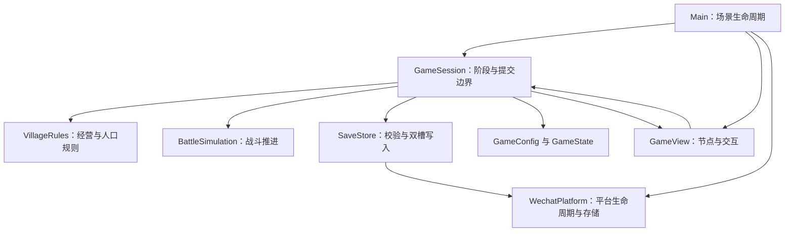

# 代代守村：Laya 技术设计

版本：v0.1。日期：2026-11-10。状态：基于本地工程的拟实施设计，尚未创建以下业务模块，也未验证微信包体。

业务规则、数值和异常结果以 [01 游戏设计](01_游戏设计.md) 为准。本文不额外定义另一套生育、退休、缺粮或恢复策略。

## 1. 真实工程基线与证据

检查基线提交为 `200d1d1a166fdb96b8cc7ff2f00d0c7c305537fe`。本次检查时工作区干净，分支为 `main`，领先本地记录的远端分支 1 个提交；该状态只代表检查时刻。

| 已存在的文件 | 已核实事实 | 对实现的影响 |
| --- | --- | --- |
| [Main.ts](../../project/LayaProject/src/Main.ts) | 继承 Laya.Script，只有 onStart 日志 | 可以复用作为场景生命周期入口，业务仍需实现 |
| [Scene.ls](../../project/LayaProject/assets/Scene.ls) | 空的 Scene2D，没有子节点或组件 | 需要挂 Main 并建立游戏节点层次 |
| [BuildSettings.json](../../project/LayaProject/settings/BuildSettings.json) | 启动场景 UUID 对应 Scene.ls | 继续沿用现有启动场景路径 |
| [PlayerSettings.json](../../project/LayaProject/settings/PlayerSettings.json) | 开启 laya.ui 与 laya.d3 | 后续测量 2D 必需模块，核对能否裁去 d3 |
| [LayaProject.laya](../../project/LayaProject/LayaProject.laya) | version 为 3.4.2 | 实施时还要核对实际 IDE 版本 |
| [tsconfig.json](../../project/LayaProject/tsconfig.json) | ES6、strict 开启、strictNullChecks 关闭 | 沿用现有语言配置；不夹带全项目编译选项调整 |
| [LayaAir.d.ts](../../project/LayaProject/engine/types/LayaAir.d.ts) | 提供引擎类型声明与接口说明 | 可以核对 API 是否存在，不能替代真机行为验证 |

工程中没有 `.codegraph/`，本次用文件读取与结构查询定位。没有项目级 `package.json`、现成业务框架、单元测试命令或完整微信发布输出；不得把拟定的构建命令写成已存在工具。

`bin/js/bundles` 中有两个仅注册 Main 的编译脚本。它们通过了 JavaScript 语法检查，但不能证明 Main 被挂载、游戏运行正常或微信发布成功。

## 2. 技术路线与范围

### 2.1 建议路线

- 使用现有 Laya 3.x 工程和 TypeScript，做 2D 场景。
- 业务数据与规则不引用 Laya 节点，方便独立验证结算、家庭、波次和存档。
- 使用少量 Laya 场景节点、贴图图集和普通 UI 完成显示与交互。
- 固定道路用路径距离计算，不依赖导航网格或物理引擎。
- 首版逻辑攻击即时命中，弹道只负责表现，避免引入大量投射物实体。
- 每次提交改变进度的操作形成一个完整快照，统一经过保存边界。

这是一份技术建议；能否在现有版本下满足完整单包限制，取决于 P0 的实际发布结果。

### 2.2 选择依据

| 方案 | 取舍 | 决策 |
| --- | --- | --- |
| 现有启动场景挂 Main，配少量纯 TS 模块 | 复用当前结构，场景清楚，业务可单测 | 采用 |
| 单个巨大脚本包办 UI、经济和战斗 | 初期快，但存档、结算和界面容易相互修改 | 不作为详细实现结构 |
| 通用 ECS、跨层 Manager/VM/Model 转发 | 可服务复杂大型游戏，但当前规模缺少收益 | 首版不引入 |

除 Main 之外，后文的类名和文件名均为拟新增设计。名字不代表已经存在接口，实施时仍需按确认后的文件计划创建。

## 3. 启动与退出生命周期

### 3.1 单一场景入口

继续使用 BuildSettings 指向的 Scene.ls，在 Laya IDE 中把现有 Main 脚本挂载到该场景根节点，并验证保存结果中引用正确的脚本资源 UUID。

引擎初始化由 Laya 的发布启动流程负责；Main.onStart 负责业务初始化，避免在里面再次调用 Laya.init。IDE 预览须选择启动场景，不能用“当前场景能打开”代替发布入口验证。

Laya 官方说明支持启动场景和显式启动脚本两种入口；本项目选择前者，依据是当前已经设置了 startupScene。[Laya 官方：项目启动入口说明](https://layaair.com/3.3/doc/basics/IDE/entry/readme.html)

建议初始化顺序：

1. 获取平台与安全区信息，初始化前后台事件订阅。
2. 加载随包配置和必需图集，校验配置引用与边界。
3. 读取两个存档槽，分类为新用户、有效进度、需要恢复或不可载入。
4. 有有效存档时显示继续入口；新用户显示开始入口。恢复问题交由明确的恢复界面处理。
5. 创建 GameSession 和场景显示，进入保存阶段对应的界面。
6. 注册唯一的主更新入口，开始处理战斗帧与表现。

配置或资源失败不默默使用占位村庄。阻止进入不可用的玩法界面，提示重试；未知配置不自动用“0”“空数组”或第一个枚举替代。

### 3.2 暂停与销毁

使用一个会话级暂停原因集合，至少区分用户暂停、进入后台、阻塞式选择、保存等待。只在集合为空时推进战斗，关闭一个面板不能解除其他暂停原因。

- onDisable：暂停当前会话，不推进战斗或动画计时。
- onDestroy：解除平台与界面事件监听，停止属于该场景的计时器、声音和临时表现，释放会话持有的资源引用。
- 新开村：复用同一场景时先销毁上一局运行实体，替换状态并重新绑定显示；不能叠加第二个更新循环。
- 后台再回来：清空帧累积余量，并保留“等待玩家继续”的暂停原因，避免把后台时间转换成敌人移动。

普通 UI 动画可以使用 Laya 的计时或缓动能力，但业务成长、生产、波次和退休只能由游戏阶段推进。

## 4. 模块职责与依赖

图中 B 与 C 的双向箭头表示命令与状态展示，不要求彼此持有强引用。界面提交明确命令；会话返回结果和只读状态，由入口协调刷新。

### 4.1 拟新增文件

路径均相对 `project/LayaProject/`，本轮只记录计划，不创建这些源码。

| 拟定路径 | 职责 | 不能承担的职责 |
| --- | --- | --- |
| src/Main.ts，复用 | 依赖组装、Laya 生命周期、安全区和主循环接入 | 大段经济或战斗规则 |
| src/game/GameConfig.ts | 已校验配置、稳定业务枚举、参数定义 | 运行中的人口与资源 |
| src/game/GameState.ts | 可序列化类型、状态不变量 | Laya 节点与贴图引用 |
| src/game/GameSession.ts | 接收命令、阶段切换、创建候选状态、提交保存 | 每种 UI 的像素布局 |
| src/game/VillageRules.ts | 生产口粮、生育条件、成长退休、有限家谱 | 平台 API 和弹窗创建 |
| src/game/BattleSimulation.ts | 波次执行、选敌、伤害、减速、胜败 | 直接读写长期存档 |
| src/game/WaveGenerator.ts | 按配置和随机状态生成有限波次 | 依据渲染帧率抽怪 |
| src/game/SeededRandom.ts | 可序列化的固定算法随机流 | 使用现实时间隐式重置种子 |
| src/storage/SaveStore.ts | 版本、结构、校验和、双槽写入及读取结果分类 | 默默清档或决定回退 |
| src/platform/WechatPlatform.ts | 仅接微信，订阅与释放前后台事件，暴露存储结果 | 经营兜底或奖励规则 |
| src/view/GameView.ts | 层次、HUD、点选与面板显示，绑定状态 | 修改资源和年龄 |
| src/view/VillageView.ts | 建筑与村民外观、局部刷新 | 决定人口增长或退休 |
| src/view/BattleView.ts | 敌人位置、塔动作、血条和有限特效 | 计算命中或判定胜负 |
| src/view/Panels.ts | 首版少量操作面板与待选队列呈现 | 跨面板持有另一份业务真相 |

如果首版面板实际很少，先保持在 GameView 内；只有出现明确的生命周期、复用或复杂度边界时再拆 Panels。避免仅为目录对称添加空转发方法。

### 4.2 命令与刷新

拟定命令包括：分配白天岗位、分配塔位、成家、迎接孩子、建造、升级、改建、修门、处理旅人、选择专长、选择村规、调整年度挑战、开始守夜、敲警钟和确认重开。

命令处理返回成功结果或明确的失败原因及所需数量。例如生育失败应区分人口满、缺粮、年龄不足、家庭冷却和照料人冲突，不用统一的 false 迫使界面重新猜测。

持久化命令使用候选状态执行和校验，写入并读回确认后替换当前状态。写入前校验失败时保持原状态；尝试写入后的异常属于提交结果未确认，界面可以暂时显示上一份已确认状态，但必须冻结其他进度命令，不能断言存储仍是旧状态。核对完成后一次成功只产生一次必要的界面刷新和反馈事件。

夜间警钟、暂停和驻塔临时调整不每帧写盘；它们属于本次战斗运行态。进程结束后按已保存战前状态重新开始这一夜，是显式规则。

## 5. 数据结构设计

以下是拟定的数据合同，需在实现时定义为类型。字段名可以直接描述现有数据结构；业务枚举和值需要集中说明来源和语义。

### 5.1 顶层存档载荷

| 字段 | 内容 | 边界 |
| --- | --- | --- |
| schemaVersion | 数据结构版本 | 未知新版不能猜测读取 |
| configVersion | 影响数值与生成的规则版本 | 与快照校验、版本迁移配套 |
| phase | DAY、NIGHT、DAWN、GAME_OVER 等阶段 | 不能写入未完成的半次提交 |
| run | 当前村庄状态或已结束结果 | 只有 1 局 |
| legacy | 已发现天赋、有限记录、收藏、最高纪录 | 不含永久战力叠加 |
| settings | 音乐、音效等用户选项 | 与业务默认值明确区分 |
| pendingChoices | 已生成、尚未选择的成年/旅人/村规/年度事项 | 有限队列，不重抽 |
| tutorial | 已完成的初次引导步骤 | 有限布尔或枚举记录 |

### 5.2 村庄 RunState

| 字段 | 含义 |
| --- | --- |
| runId / nextVillagerSeq | 本局唯一身份和人物编号序列 |
| day / completedNights | 当前准备第几天，以及已成功守住的夜数 |
| challengeTier / currentPolicyId | 当前年度挑战档与当季村规 |
| food / wood | 0～200 的资源整数，实际上限来自配置 |
| gateHp | 0～200 的村门生命，实际最大值来自配置 |
| buildings | 民居数量、农田等级、伐木点等级 |
| villagers | 最多 20 个在场人物 |
| families | 配偶 ID、尚未成年孩子 ID 与上次出生对应的成功夜数；首次未生育明确用空标记，不需要等满冷却；数量不超过在场成人的一半 |
| towers | 固定长度 4，可为空塔位 |
| rng | 家庭、世界、战斗三条随机流的状态 |
| plannedWave | DAY/NIGHT 的已确定敌人类型、次序、参数和出场计划；DAWN 待选阶段尚未生成 |
| lastDawnCompletedDay | 已成功提交的最后一次胜利对应日，防重复结算 |
| nightCheckpoint | 当夜战前资源与规则快照所需信息，避免完整递归嵌套 |

`nightCheckpoint` 不复制整个顶层存档到自己内部。NIGHT 阶段的 RunState 本身就是已结算的战前持久化基线，checkpoint 只记录该夜所需的锁定岗位、随机种子、波次引用与状态标识。

### 5.3 人物 Villager

| 字段 | 含义与约束 |
| --- | --- |
| id | 本局唯一，退休后不复用 |
| name / appearance | 有界文本和有限整人造型索引，不存图片 |
| sex | 明确的拟定性别枚举；未知值校验失败 |
| stage | CHILD 或 ADULT；退休人物进入历史记录 |
| origin | FOUNDER、TRAVELER、BORN，区别外来血缘和资料缺失 |
| parentIds | 初始/旅人为明确空列表；出生人物恰有两个有效身份编号 |
| liveAncestorIds | 当前仍在场的直系祖先 ID，最多 20 个 |
| traitId / specialtyId | 先天天赋；孩子尚无专长，待选成人可暂缺但须有待选记录 |
| growthNights | 孩子已获得的有效成长次数 |
| adultNightsRemaining | 成人剩余任职夜数；孩子不使用此字段 |
| spouseId | 在场配偶，双方必须相互对应 |
| dayAssignment | 农田、伐木、照料指定孩子或待命 |
| towerSlotId | 夜间塔位或空；与塔的操作员引用一致 |
| birthDay / generation | 出生日与展示代数，不作为家谱裁剪窗口 |

建议只由人物或塔的一侧保存实际驻塔关系，另一侧建立只读索引；若选择双向序列化，必须在校验中验证一致，不能让两份映射分别更新。

### 5.4 亲缘集合为何有界

出生时，孩子的在场祖先集合为“父母 ID，加父母仍在场祖先 ID 的并集”。退休时，从所有在场人物的祖先集合删除退休者 ID，因为退休者永不返回可成家人口。

配对检查：一方在另一方的在场祖先集合中，则禁止；父母 ID 列表有非空交集，也禁止。这样可以识别仍在场的祖父母等直系关系，同时共享父母在退休后仍能阻止兄弟姐妹成家。

历史人物详情裁剪不删除当前人物保存的 parentIds，不以空值推导无亲缘。出生关系只基于稳定 ID，不能基于姓名、头像、家谱显示位置或代数比较。

### 5.5 状态不变量

每次持久化提交前校验：

1. 人数不超过住房容量且不超过 20；资源和门血在配置允许范围内。
2. 人物 ID 唯一，配偶双向一致，无禁止亲缘组合。
3. 孩子没有生产或塔位；一个成人不重复占白天岗位或多个塔位。
4. 一个孩子最多有一名照料者，一个成人最多照料一个孩子；照料目标必须是在场 CHILD，成年后旧照料者转为待命。
5. 固定塔位不超过 4，等级与类型合法；有操作员的塔指向在场成人。
6. 全部 trait、skill、policy、enemy、building 等 ID 存在于当前配置。
7. 阶段与快照内容对应；NIGHT 必须包含完整已结算战前信息，DAY 必须有最终挑战档生成的波次，DAWN 不使用上一夜波次。
8. 待选项无重复 ID，候选合法；成年未选专长的人有相应待选事项。
9. 历史 60 条与收藏 20 条均有界，展示资料不参与生育可行性推断。

未知字段可以在明确版本合同中允许忽略；未知业务枚举、引用或必需字段不能自动忽略或补默认。

## 6. 状态提交与规则执行

### 6.1 三类边界

| 边界 | 保存时机 | 失败后的状态 |
| --- | --- | --- |
| 白天持久化操作 | 操作确认后、播放完成反馈前 | 写入前校验失败保持原状态；尝试写入后异常冻结并核对同一候选提交 |
| DAY 到 NIGHT | R01～R06 完成，敌人开始前 | 留在冻结的准备界面，核对同一次资源结算 |
| NIGHT 到 DAWN 或 GAME_OVER | 计算一次完整结果后、展示结算前 | 暂停等待确认，核对或重试同一候选结果 |
| DAWN 到 DAY | 全部清晨选择完成、波次已按最终挑战档生成 | 等待同一候选波次提交，不重新生成 |

玩家快速连点时使用命令序列或进行中标记，未完成一次提交前不再次执行同一持久化动作。按钮禁用只是交互辅助，业务入口仍需拒绝重复命令。

### 6.2 年龄和资源顺序

严格引用 [01 的 R01～R15](01_游戏设计.md#3-阶段与唯一结算顺序)：生产和口粮只在开战前，成长和退休只在成功守夜后。不得在 Main.onUpdate 中用现实秒数推动年龄。

成年结算以战前成人集合为准，避免刚转成人的人立刻少一夜任职期；孩子成年时将原照料者改为待命并清除照料引用。可视动画在确认保存后播放，动画中断不影响已提交结果。

年度挑战待选处理完成之前不生成新年第一夜波次。DAWN 快照保存已经确定的候选和随机状态；最后一项选择完成后，才生成并提交带最终挑战档的 DAY 状态。中途重进继续原队列，不能提前用旧档创建波次。

### 6.3 随机结果

使用固定算法的有种子随机数，不直接让业务规则依赖 Math.random。世界、家庭、战斗分开保存随机流，界面动画不消耗这些随机状态。

- 出生、旅人、村规、成年候选都在对应提交中固定并存档。
- 战前锁定波次与战斗随机状态；恢复时读取同一结果。
- 生成算法或配置版本变更需要迁移或新局策略，不以新规则重新抽取旧夜晚。
- 调试复现保留构建版本、规则版本、随机状态、当日配置与玩家操作，才能区分随机差异和逻辑错误。

本方案提供可复现性，不声明本地单机具备防修改、防回档或严格防作弊能力。

## 7. 战斗模拟与表现分离

### 7.1 固定逻辑步

建议业务模拟使用 20 Hz，即每步 50 毫秒；渲染按设备和 Laya 实际帧率刷新。倍速通过增加逻辑时间推进，不直接把不同系统的速度各改一遍。

每步按固定顺序：

1. 处理已接受的本步战斗命令，例如警钟或暂停后的换岗。
2. 更新有效增减益，处理到时出场与有限召唤队列。
3. 按稳定编号更新敌人位置，收集到门事件；同一步到门伤害先结算。
4. 门血归零则立即结束，不再用随后攻击挽回。
5. 更新塔冷却，按固定选敌规则计算攻击和即时伤害。
6. 移除死亡实体，回收表现；检查是否满足胜利条件。

视图根据路径进度计算坐标，允许插值表现，不反向把节点当前位置当作规则输入。

### 7.2 长帧策略，待确认的技术行为

单帧输入的真实经过时间最多记 250 毫秒，再乘游戏倍速；最多处理 10 个 50 毫秒逻辑步。超出真实经过时间被舍弃，表现为卡顿期间游戏时间放慢，不突然跳过整段战斗。

这是明确的长帧处理建议，须在实现前确认并在性能测试中验证。后台停留时间直接不计入，不能使用此规则补算后台战斗。

### 7.3 对象与数量上限

| 对象 | 建议上限 | 达到上限时的规则 |
| --- | ---: | --- |
| 在场村民 | 20 | 生育/接纳入口拒绝并说明 |
| 同屏敌人 | 40 | 已计划敌人排队，腾位后进入 |
| 普通出场队列 | 80 | 配置与生成阶段保证不越界 |
| 首领召唤请求 | 4 | 按固定额度生成一次 |
| 塔 | 4 | 只允许固定塔位 |
| 攻击与受击表现 | 32 | 合并或省略重复装饰表现，伤害照常结算 |
| 家谱历史 / 收藏 | 60 / 20 | 按已公布规则保留 |
| 调试日志 | 发布版默认关闭；开发版建议环形 200 条 | 覆盖旧日志，不写无限文件 |

省略装饰特效是可见表现上的降级建议：只在超过表现上限时合并重复火花或数字，不省略警钟可用状态、门血、敌人存在或关键错误提示。

## 8. 存档格式与双槽方案

### 8.1 存储封套

每个槽保存一个完整字符串封套，包括：schemaVersion、configVersion、revision、commitId、payload、checksum。commitId 是本次候选提交的稳定标识，重试不能重新生成；checksum 建议为规范化 UTF-8 内容的 CRC32，计算对象是去掉 checksum 字段后的封套，键序与编码规则固定。它用来发现意外截断和内容损坏，不作为安全签名。

revision 为单调增加的提交序号，写入前验证为安全整数。payload 必须完成结构、枚举、引用和阶段校验；只有校验和正确仍不足以认为状态合法。

设置两个固定槽位，例如 `daidai_village.save.a` 和 `daidai_village.save.b`。键值来源、用途和变更影响需写入对应常量注释。不会按日期或每次保存新增一个键。

### 8.2 写入过程

1. 根据最后一次成功提交创建候选状态，执行命令和不变量检查。写入前失败可直接拒绝该命令。
2. 一次性分配新 revision 与 commitId，计算校验和，序列化完整封套。保留目标槽、精确字节内容、候选状态，以及两个槽写入前的预期记录指纹（首次不存在也明确记录），进入待确认提交状态并冻结其他持久化命令。
3. 写入较旧或空的槽，保留上一份有效记录。
4. 立即读回目标槽，比较封套、revision、校验和及结构。
5. 成功后把候选状态标记为当前已提交状态，再通知 UI 操作完成。
6. 一旦尝试过写入，异常或读回不一致都进入提交结果未确认状态，不覆盖另一槽、不自动清空缓存，也不把当前操作回报为确定未发生。

重试时先核对两个槽和预期基线：另一槽仍是预期的上一份提交（首次保存时为不存在），且目标内容、commitId、revision 与候选完全一致并有效，则直接确认完成；目标为空、损坏，或仍是本次原计划覆盖的较旧有效记录，同时另一槽基线未变时，可重写同一候选字节内容。若暂时无法读取，继续保持待确认并提示重试；若出现更新的有效提交、同序号不同内容或任何不符合预期的有效基线，则提示冲突而不是覆盖。整个过程不再次运行生育、扣粮、随机生成或年龄结算。

进程被结束后若候选已完整写入，启动读取会把它作为最新有效记录承认，即使上一进程尚未播放成功反馈。若未写入，则只能恢复旧快照或进入明确的恢复流程。保存错误提示应写成“保存状态暂未确认，请重试”，不承诺一定回滚。

不假设平台提供跨多个键的原子事务。双槽能够降低单次写入损坏的影响，但仍不能保证系统清理、存储介质损坏或人为修改后恢复。

### 8.3 读取与恢复决策

| 槽状态 | 读取结果 | 产品动作 |
| --- | --- | --- |
| 两槽均不存在 | 没有历史进度 | 正常显示新建村庄 |
| 两槽有效且版本可读 | 选择 revision 更高者 | 正常继续 |
| 一槽有效，另一槽不存在 | 单份有效进度 | 正常继续，例如第一次保存 |
| 一槽有效，另一槽损坏 | 可能需要恢复 | 显示有效记录时间点，由玩家确认恢复 |
| 两槽都存在但均不可用 | 无法读取 | 保留原数据，提供明确确认的新开村入口 |
| 任一槽属于无法识别的新版本 | 版本冲突 | 停止自动选择旧记录，提示使用兼容版本处理 |
| 两槽 revision 相同但内容不同 | 记录冲突 | 不擅自择一，进入异常提示 |

版本迁移需要明确的来源版本、字段映射与回归用例。没有经过验证的迁移函数时不自动填默认字段，也不把旧夜晚套进新波次算法。

### 8.4 退出恢复与诚实边界

- 白天恢复实际读到的最新有效提交；尚未获得完成反馈的操作也可能已写入，应以该提交为准，不再次执行。
- 同一进程的夜间后台切换在内存原地暂停，返回后继续。
- 夜间进程被结束后从该夜战前状态重打，资源消费不再执行，敌人计划保持不变。
- DAWN 已保存后，恢复待选择队列，不再执行 R08～R14。
- 结果计算后、保存前被系统结束，仍只能恢复上一份已提交快照；可能重打一夜。双槽不能把未写入的数据找回来。
- 最后一次写入成功、反馈播放前被结束，重进按已提交结果显示；不能再次扣费或发放结果。

## 9. 平台接入与已验证 API

### 9.1 本地声明已核对的能力

| 能力 | 本地声明证据 | 拟用途 |
| --- | --- | --- |
| regClass | LayaAir.d.ts 约第 871 行 | 让脚本可序列化，不等于实例化 |
| Component.onStart / onUpdate / onDestroy | 约第 5276～5323 行 | 初始化、主循环和销毁 |
| Node.addComponent | 约第 24790 行 | 必要时的程序挂载，首选场景保存挂载 |
| Stage.SCALE_SHOWALL / SCREEN_VERTICAL | 约第 27395 / 27465 行 | 全内容可见的竖屏适配 |
| Timer.delta / unscaledDelta | 约第 92900 / 92905 行 | 获取毫秒级帧间隔，注意不要重复施加倍率 |
| Timer.clear / clearAll | 约第 93005 / 93012 行 | 清理属于场景的计时回调 |
| wx.getStorageInfoSync / getStorageSync / setStorageSync | 当前官方声明与 WechatPlatform | 微信专用存储，区分缺失和读取异常 |
| Scene.open | 约第 25380 行起 | 有需要时打开场景，首版不扩展多场景跳转 |

行号用于定位检查时的版本，实施时优先重新查看对应符号。声明存在不代表微信适配层已经通过验证。

### 9.2 微信专用接入

WechatPlatform 直接接入微信的隐藏、显示、安全区和同步存储接口，转换为项目内的明确事件与结果。用户已明确只做微信；当前实现记录见 [首版实现与运行](../tech/04_首版实现与运行.md)。

存储故障注入在纯 TypeScript 测试中使用内存夹具，夹具不进入运行包。实际游戏只使用微信存储，不提供浏览器 localStorage 回退；真机存储异常仍要单独验收。

单机不需要账号登录或自建服务器。首次下载、微信宿主启动和平台自身行为与业务离线是不同边界，分别验收。

## 10. 场景与界面组织

### 10.1 建议节点层次

当前实现下分为地面、共同世界层、战斗特效、HUD、面板与遮罩。建筑、树木、村民和敌人均放入共同世界层，按脚底深度排序，不能把建筑和人物拆到固定前后层。世界层设置独立渲染排序范围；具体实现见 [村民自主行为与遮挡](../tech/05_村民自主行为与遮挡.md)。

固定地图和房屋只在建设或季节变化时更新；人物动作和敌人位置按需要刷新。资源文字、人口和门血在值变化时更新，避免每帧重新创建文本或整个列表。

### 10.2 屏幕适配

- 基准 720 × 1280，竖屏。
- 先获得可用安全区域，再按宽高较小缩放比例完整显示游戏；额外区域绘制简单背景。
- 本地已确认 SCALE_SHOWALL 与 SCREEN_VERTICAL 存在，但微信 game.json 方向和安全区处理仍必须通过发布产物与真机确认。
- 输入坐标先转换到游戏设计空间，再做选中判断，不把设备像素直接与逻辑塔位比较。
- 胶囊和手势区域不放按钮或唯一的信息入口。
- 面板关闭恢复之前的选择；关闭结果展示不改变业务提交。

### 10.3 UI 资源策略

先使用简单九宫格背景、图集图标和系统中文字体。现有 atlas/comp 是通用模板资源，只保留实际引用项；不能仅因资源存在于工程就全部纳入发布。

不得以第三方完整 UI 主题或整套字体一次性引入大量文件。图标和面板由资源清单列出明确使用位置，动态路径资源通过发布配置验证确实包含。

## 11. 包体预算与资源清单

### 11.1 硬边界

微信官方文档当前写明主包不超过 4M。本项目按更严格的完整单包目标执行，内部建议控制到 3,500,000 字节，预留平台统计和后续调整空间；最终以开发者工具上传校验为准。[微信开放文档：分包加载](https://developers.weixin.qq.com/minigame/dev/guide/base-ability/subPackage/useSubPackage.html)

这里的 MB 按 1,000,000 字节预算；不混用源码目录体积、ZIP 体积、GPU 内存和平台计包体积。每次记录同时保留字节数与统计方法。

### 11.2 相比早期概念稿的必要修订

早期概念稿按轻量绘制代码估计，没有实测 Laya 运行时。本稿单独计入引擎和微信适配；以下各项只是可讨论的配额，不是测量结果或可达性承诺。

| 发布内容 | 建议配额 | 验证方法 |
| --- | ---: | --- |
| Laya 必需运行代码与微信适配 | 1,500,000 字节 | P0 最小发布包逐项统计 |
| 游戏业务脚本 | 250,000 字节 | 发布压缩后的脚本，不计 TS 源码 |
| 地块、人物、建筑与敌人图集 | 900,000 字节 | 实际发布图片与图集元数据 |
| UI 图标、面板与简单特效 | 200,000 字节 | 逐文件核对使用位置 |
| 音乐与音效 | 350,000 字节 | 最终格式与时长实测 |
| 场景、配置、文案及杂项 | 100,000 字节 | 发布目录与平台统计对照 |
| 内容预算合计 | 3,300,000 字节 | 上述分类求和 |
| 缓冲 | 200,000 字节 | 不预先分配为新功能 |
| 内部目标 | 3,500,000 字节 | 以实际包计量判定 |

引擎配额若无法达到，不能把超过部分藏到“杂项”。重新列出实际体积与剩余空间，再缩减范围或确认技术路线变化。基础运行包如果已经无法给必要内容留出空间，应暂停后续内容制作。

### 11.3 资源组织建议

| 内容 | 组织建议 | 数量与复用 |
| --- | --- | --- |
| 地图 | 地块图集和少量可平铺背景 | 一张地图，季节通过参数表现 |
| 房屋与设施 | 同图集少量建筑外观 | 等级以小部件或标识区分 |
| 村民 | 预制整人序列帧与有限造型索引 | 同身份的动作配套，实际覆盖以资源规范为准 |
| 敌人 | 5 类行为对应少量基础形体 | 颜色、大小和装饰区分 |
| UI | 一张小图集加系统字体 | 不随包带完整中文字体 |
| 动画 | 人物每动作 2～4 帧，配程序位移 | 本轮每组 4 帧，首版不使用 Spine/龙骨资源 |
| 声音 | 短循环音乐、短音效 | 不含语音与长歌曲 |

建议拆成 2～3 张不超过 1024 × 1024 的图集，是否合并最终由 Draw Call、包体和真机内存共同决定。一张 1024 × 1024 的 RGBA8 纹理解码后基础数据约 4 MiB，图片文件很小也不代表显存同样小。

后续详细合同与实际候选资源见 [详细技术实现](../tech/01_详细技术实现.md) 和 [图片与序列帧规范](../tech/02_图片与序列帧资源规范.md)。提前准备素材不代表 P0 已通过；当前没有将这些图片导入 Laya 或完成实际微信计包。

文档目录、概念大图、工具脚本、原始 PSD、引擎声明 `.d.ts`、调试 sourcemap 和未引用模板素材不应进入发布。是否排除成功必须核对最终文件清单，而不是只看源目录位置。

## 12. 发布与验证流程建议

Laya 官方通用发布页提供引擎库和业务脚本压缩、场景与资源包含等设置；应从 IDE 保存并检查实际生成配置，不在本文猜测一条项目里不存在的 npm 构建命令。[Laya 官方：通用发布设置](https://layaair.com/3.3/doc/released/generalSetting/readme.html)

开发顺序：

1. 核对本机 IDE 与项目版本；沿用现有工程，验证 Scene.ls 的 Main 挂载。
2. 保留所需 2D/UI 模块，核对 d3 与其他非必要模块依赖，再生成最小微信样本。
3. 从 IDE 的构建发布界面选择微信小游戏；保存正式压缩设置，使用实际输出路径。
4. 检查 game.js、game.json、运行库、业务脚本、场景和引用资源完整，方向符合竖屏。
5. 导入微信开发者工具，记录工具统计的包体与文件分类；真机打开场景并验证资源不从远端补齐。
6. 第一条可玩链路形成后再次计包，不能只保留空工程的体积记录。
7. 完整资源加入后执行全量验收，记录实际 iOS/Android 设备、微信版本和构建标识。

微信发布环境与浏览器环境不同；IDE 或 Web 预览不能代替微信真机验证。[Laya 官方：微信小游戏发布](https://layaair.com/3.3/doc/released/miniGame/wechat/readme.html)

文档只规划构建，不执行上传、提审或发布。后续测试脚本、截图、日志与计包记录放在 `/Users/happyelements/Downloads`，不混入源代码与文档资源清单。

## 13. 配置与常量维护要求

- 数值、概率、阶段、资源类型、天赋 ID、岗位、攻击类型和存档版本必须有明确归属。
- 初版优先在 GameConfig 与业务类型定义中维护，不创建一个跨所有模块的杂项常量文件。
- 每项可调整参数说明业务含义、来源为本稿哪一节、单位、适用范围及变化影响。
- 影响已生成波次或存档解释的调整必须变更 configVersion，并制定兼容处理。
- 普通字段 key 可以直接使用；业务枚举值不能在多个 UI 文件里重复写字符串。
- 引用不存在的 ID、超过上限的波次或非法概率属于配置错误，加载时明确失败，不以默认值掩盖。

## 14. 性能与可观测性目标

以下是验收目标，需要在指定真机上测量：

| 指标 | 建议目标 | 证据要求 |
| --- | --- | --- |
| 显示帧率 | 常规目标 60 FPS，选定低端机持续不低于约 30 FPS | 记录机型、场景、采样时段与帧时间分位数 |
| 逻辑频率 | 20 Hz，暂停时 0 推进 | 固定输入下不同渲染帧率结果一致 |
| 核心持久化载荷 | 单份目标不超过 128 KiB | 包含 20 人、60 历史、20 收藏的最坏样本 |
| 保存提交 | 目标单次不出现可感知长卡顿 | 真机记录耗时；不宣称同步写入必然快 |
| 长期数量 | 10,000 夜规则模拟后实体和存档长度仍有界 | 计数曲线、断言结果，不等同于好玩验证 |
| 运行内存 | 同一最坏场景循环后无持续增长趋势 | 同机型多次快照，不能用包体推断内存 |

调试信息只记录必要阶段、配置版本、随机种子、关键命令、存档 revision 和失败原因。发布版关闭详细帧日志；不接入服务器打点来替代当前单机验收。

## 15. 技术风险与停止条件

| 风险 | 提前验证 | 不满足时的处理 |
| --- | --- | --- |
| Laya 运行时占包过大 | P0 最小发布包 | 报告实际差距，暂停内容扩充，讨论取舍 |
| UI/2D 模块依赖导致裁剪不完整 | 最小场景与代表组件发布检查 | 修正依赖与发布配置后重测，不手删必需运行库 |
| 微信存储异常被适配层吞掉 | 写入异常、读回与损坏注入测试 | 调整平台边界，保留产品可见错误 |
| 规则或版本不一致导致重进改变结果 | 固定快照跨次恢复 | 修复版本与随机合同后才能称存档完成 |
| 退休与旅人让养育失去意义 | 多代人工试玩 | 调整已有机制，不能只通过增加新系统掩盖 |
| 两倍速和长帧改变战斗结果 | 同输入多帧率对照 | 统一逻辑时间与事件顺序 |

技术门禁通过只代表对应范围的证据成立；实际留存、长期趣味和上线效果没有在本轮验证。
