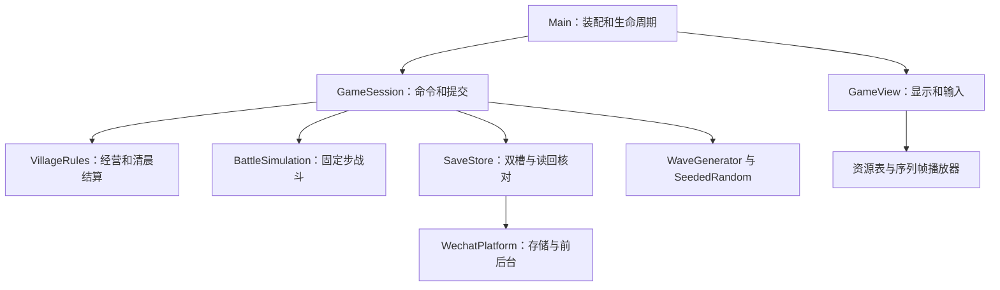
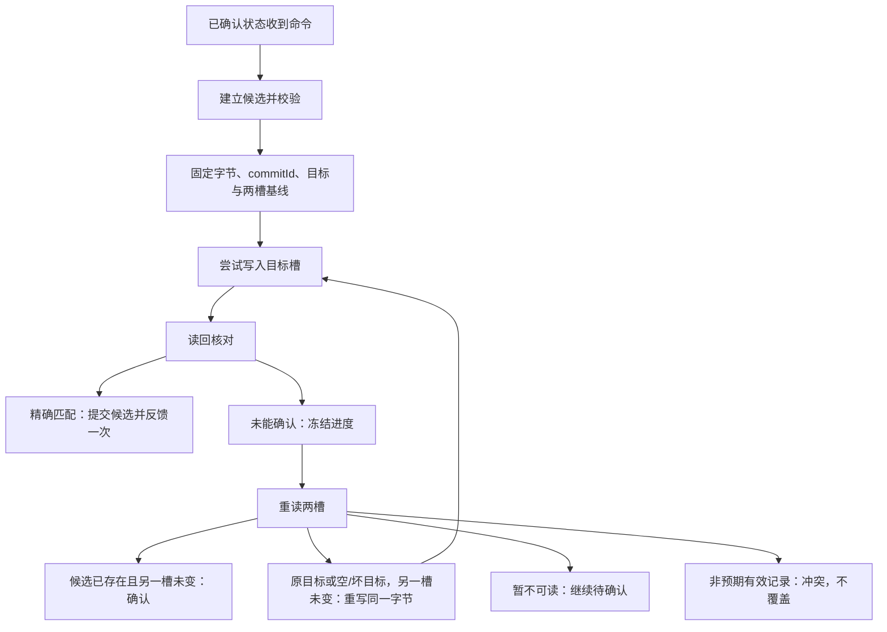

# 代代守村：详细技术实现文档

当前全面屏布局与窗口事件以 [19](19_全面屏与安全区适配.md) 为准，体验版本 1.0.4，配置版本仍为 10。

当前配置 10 的每日口粮、Legacy.lastRationDate、同候选原子保存、家庭与村庄视觉及资源分层见 [18](18_村庄视觉与每日口粮.md)。此前条件提示、游戏内手册和 15 战斗秒警钟见 [17](17_条件提示与玩法说明.md)；驻塔补人见 [16](16_防塔自动驻守.md)。

2026-11-11 持续成长更新：当时配置版本为 7。建筑、仓储、城门与敌人采用持续成长公式；新增性别偏置和断档旅人、3 倍速、原创小音乐、篝火集合与头顶表情。当前规则及验证以 [12 持续成长与村庄生活](12_持续成长与村庄生活.md) 为准，UI 与代码清理、随机抽取修复见 [13](13_UI精修与代码审查.md)，塔位覆盖与表情距离见 [14](14_塔位覆盖与表情距离.md)；本文旧版固定三级、固定 200 上限及历史体积不再代表当前版本。

2026-11-11 更新：单局最高成功防守波数好友榜、5% 精英村民及放大成家红心已实现。普通寿命 12/3 夜，精英 18/5 夜，配置版本 4；实现、资源源文件和验证边界见 [10 好友榜与精英村民](10_好友榜与精英村民.md)。下文历史测试及包体数字保留对应轮次含义。

实施更新：用户已授权开始制作，目标仅为微信小游戏。下面保留原合同及计划语境；当前完成情况、实际代码与证据见 [首版实现与运行](04_首版实现与运行.md)。

版本：v0.2 技术实施稿。日期：2026-11-10。适用工程：`project/LayaProject`，项目版本字段 `3.4.2`。

本文把 [游戏设计](../design/01_游戏设计.md) 和 [技术设计](../design/02_Laya技术设计.md) 拆成数据合同、命令、算法和开发任务，保留最初方案的拟定类型与历史基线。当前源码、场景与微信发布已实现，实际接口以 [04](04_首版实现与运行.md)、[07](07_人物动画审计与自动岗位.md)、[08](08_晚年生活与滑动列表.md) 及对应源码为准；手机微信验证仍未完成。

用户已明确：竖屏、单机、村落与人类繁衍结合塔防、轻量包体、无固定关卡终点。2026-11-11 用户要求启用微信原生分包，替代早期完整内容置于单包的约束；主包与资源包合计仍按 3,500,000 字节内部预算检查，详见 [11 微信原生分包](11_微信原生分包.md)。人物使用序列帧动画，每个动作 2～4 帧；当前照料和老人动作每组 2 帧，其余每组 4 帧。养老规则、自动安排与开发人工清档已经用户确认，最新合同见 08；具体经济平衡仍需真实试玩。

## 1. 实现基线与本轮边界

### 1.1 初始工程事实（历史基线）

| 文件 | 实际状态 | 复用方式 |
| --- | --- | --- |
| [Main.ts](../../project/LayaProject/src/Main.ts) | `Laya.Script`，只有启动日志 | 作为唯一场景生命周期入口 |
| [Scene.ls](../../project/LayaProject/assets/Scene.ls) | 空 `Scene2D`，尚未挂 Main | 后续由 IDE 挂载并保存 |
| [BuildSettings.json](../../project/LayaProject/settings/BuildSettings.json) | startupScene 指向现有 Scene | 保持单场景入口 |
| [PlayerSettings.json](../../project/LayaProject/settings/PlayerSettings.json) | 当前启用 `laya.ui`、`laya.d3` | P0 验证仅保留必要模块后的真实体积 |
| [LayaAir.d.ts](../../project/LayaProject/engine/types/LayaAir.d.ts) | 本地引擎声明可查 | 核对 API，不把声明当作运行证据 |

检查时基线提交为 `5cb2dc771a3c089210dea9c6c279bf08690ea615`。用户已将原设计文档迁入 `doc/design/`，新技术文档落在 `doc/tech/`。当前没有项目级 `package.json`、测试入口或完整微信导出包；本文不会假设已有 `npm run build` 等命令。

### 1.2 本轮交付与后续实施

本轮交付详细文档、候选 PNG、序列帧清单、图集、资源台账和静态校验记录。生成素材是用户明确要求的前置准备，不代表 P0 已通过。原始母版与预览材料留在工程外层 `res/`，后续按资源白名单导入 Laya。

历史 P0 要求先验证包含引擎、微信适配、场景、代表性 UI、纹理和保存能力的最小包。当前发布采用已获用户确认的微信原生资源分包；内部完整内容预算仍为 3,500,000 字节，主包与分包分别计量，不接入远程图片或共享引擎插件。平台上限及上传计量以微信当时规则和开发者工具实际校验为准。[微信官方：分包加载说明](https://developers.weixin.qq.com/minigame/dev/guide/base-ability/subPackage/useSubPackage.html)

## 2. 模块、数据流与文件归属



下列文件均相对 `project/LayaProject/src/`。业务输入是普通数据，禁止保存 `Sprite`、`Texture`、`Timer` 或回调闭包。

| 文件 | 对外责任 | 依赖限制 |
| --- | --- | --- |
| Main.ts | 挂载、启动、唯一帧循环、退出释放 | 可以引用 Laya 和装配模块 |
| game/GameConfig.ts | 类型 ID、数值、固定开局和配置校验 | 不依赖视图、平台、当前存档 |
| game/GameState.ts | DTO、阶段联合类型、不变量 | 纯 TypeScript |
| game/GameSession.ts | 命令串行、候选状态、保存确认、状态刷新 | 不计算像素布局，不直接调用微信 |
| game/VillageRules.ts | 日结、家庭、成长、退休和家谱 | 不执行 I/O、不播放动画 |
| game/WaveGenerator.ts | 生成一次有限波次与预告 | 只消耗指定随机流 |
| game/SeededRandom.ts | 固定算法与随机状态推进 | 不自行取时间、不使用渲染随机 |
| game/BattleSimulation.ts | 20 Hz、到门、攻击、胜负 | 不直接持久化、不读取显示节点位置 |
| storage/SaveStore.ts | 封套、校验、槽位分类、精确重试 | 不决定清档、回退或游戏奖励 |
| platform/WechatPlatform.ts | 存储结果、前后台和安全区事件 | 不定义经营默认值 |
| view/GameView.ts | HUD、面板和命令提交 | 只读取已确认状态与运行快照 |
| view/VillageView.ts | 建筑、村民、岗位表现与有限动画 | 外观变化不修改年龄与生产 |
| view/BattleView.ts | 路径插值、敌人、塔和瞬时表现 | 动画帧不造成伤害 |
| view/SpriteFrames.ts | 共享帧纹理、动作时间到帧号映射 | 有明确复用价值，服务全部角色 |

首版面板可保留在 GameView；达到独立生命周期或复杂度边界后再拆 `Panels.ts`。不添加只转发参数的 Manager、VM、Model 层。配置和常量放在最近的业务模块，不建杂项全局常量仓库。

## 3. 状态所有权与序列化合同

### 3.1 三种状态必须分开

| 状态 | 持有者 | 是否写盘 | 示例 |
| --- | --- | --- | --- |
| 已确认进度 | GameSession | 是 | 人口、粮食、波次、待选项 |
| 候选提交 | GameSession / SaveStore | 写入中 | 同一个出生、扣粮与随机结果 |
| 本夜运行态 | BattleSimulation | 否 | 敌人进度、当前门血、警钟、夜间临时换岗 |
| 纯显示态 | 各 View | 否 | 当前动画帧、选中高亮、滑动位置 |

运行态中的门血与夜间驻塔调整，在胜利候选中结转到下一天；进程被结束则按保存的战前基线重打。不能把在内存中看到的夜间结果冒充已经保存。

### 3.2 拟定核心类型

以下保留初始接口合同示例，不是当前源码或可直接编译的实现。当前实际类型以 [GameState.ts](../../project/LayaProject/src/game/GameState.ts) 为准：Person 的 elderNights 必填；儿童/劳动成人为 0，在村老人 nights=0 且 elderNights=1～3，寿终记录两者均为 0；night.elders 保存本夜已有老人 ID，night.adults 仅保存劳作成人。引用的配置 ID 均由 GameConfig 的已校验定义提供，所有必需字段在加载时验证，不自动补默认。

```typescript
type VillagerId = string; // runId 与单调序号构成，退休后不复用
type FamilyId = string;
type Sex = "MALE" | "FEMALE"; // 来源：GDD 6.1 的待确认选择
type Origin = "FOUNDER" | "TRAVELER" | "BORN";
type TraitId = string; // 值必须属于 GDD 的 8 项 ID
type SkillId = string; // 值必须属于 GDD 的 6 项 ID
type PolicyId = string; // 值必须属于 GDD 的 12 项 ID
type TowerKind = "ARROW" | "STONE" | "SLOW";
type EnemyKind = "enemy_raider" | "enemy_runner" | "enemy_armored"
  | "enemy_disruptor" | "enemy_chief";

type DayAssignment = { kind: "WAITING" } | { kind: "FARM" }
  | { kind: "LOGGING" } | { kind: "CARE"; childId: VillagerId };

interface PersonBase {
  id: VillagerId;
  name: string; // 有界显示名，配置/生成源受控，不写图像数据
  sex: Sex;
  origin: Origin;
  parentIds: VillagerId[]; // 外来者恰为 0；本村出生者恰为 2
  liveAncestorIds: VillagerId[]; // 去重且只包含当前在场人物
  traitId: TraitId;
  appearanceVariant: number; // 有限造型索引，非部件图层或业务属性
  birthDay: number;
  generation: number;
}
interface Child extends PersonBase {
  stage: "CHILD";
  growthNights: 0 | 1;
}
interface Adult extends PersonBase {
  stage: "ADULT";
  adultNightsRemaining: number;
  specialtyId: SkillId | null; // null 只可伴随该人的成年待选项
  dayAssignment: DayAssignment;
}
type Villager = Child | Adult;

interface Family {
  id: FamilyId;
  partnerIds: [VillagerId, VillagerId];
  childId: VillagerId | null;
  lastBirthCompletedNights: number | null; // null 是首次生育，不等于 0
}
interface Tower {
  kind: TowerKind;
  level: 1 | 2 | 3;
  operatorId: VillagerId | null;
}
interface RngState { family: number; world: number; }
interface RunCommon {
  runId: string;
  nextVillagerSeq: number;
  nextFamilySeq: number;
  day: number;
  completedNights: number;
  challengeTier: 0 | 1 | 2 | 3;
  currentPolicyId: PolicyId | null;
  food: number;
  wood: number;
  gateHp: number;
  buildings: { houses: number; farmLevel: 1 | 2 | 3; loggingLevel: 1 | 2 | 3 };
  villagers: Villager[];
  families: Family[];
  towers: [Tower | null, Tower | null, Tower | null, Tower | null];
  rng: RngState;
  stats: {
    births: number;
    retirements: number;
    maxGeneration: number;
    newTraitIds: TraitId[]; // 本局首次发现的集合，最多 8 项
  };
}
interface PlannedEnemy {
  seq: number;
  kind: EnemyKind;
  spawnTick: number;
  hp: number;
  speed: number;
  armor: number;
  gateDamage: number;
}
interface PlannedWave {
  day: number;
  tier: number;
  threatBudget: number;
  affix: "NONE" | "FAST" | "STURDY" | "GROUP";
  entries: PlannedEnemy[]; // 最多 80，包含固定首领，不含 4 个召唤请求
}
interface NightCheckpoint {
  nightId: string;
  adultIdsAtStart: VillagerId[];
  caredChildIdsAtStart: VillagerId[];
  hunger: boolean;
  battleRngAtStart: number;
  production: { food: number; wood: number; rations: number };
}
type Choice =
  | { id: string; kind: "SPECIALTY"; personId: VillagerId;
      candidates: [SkillId, SkillId, SkillId] }
  | { id: string; kind: "TRAVELER"; person: Adult }
  | { id: string; kind: "POLICY";
      candidates: [PolicyId, PolicyId, PolicyId] }
  | { id: string; kind: "YEAR_TIER"; candidates: [0, 1, 2, 3] };

type PhaseState =
  | { phase: "DAY"; run: RunCommon; wave: PlannedWave }
  | { phase: "NIGHT"; run: RunCommon; wave: PlannedWave; checkpoint: NightCheckpoint }
  | { phase: "DAWN"; run: RunCommon; pendingChoices: Choice[] }
  | { phase: "GAME_OVER"; run: RunCommon; failedNightId: string;
      summary: { completedNights: number; maxGeneration: number;
        births: number; retirements: number; newTraitIds: TraitId[] } };

interface PersonRecord {
  id: VillagerId;
  name: string;
  parentIds: VillagerId[];
  sex: Sex;
  appearanceVariant: number;
  traitId: TraitId;
  specialtyId: SkillId | null;
  generation: number;
  birthDay: number;
  retiredDay: number;
}
interface SavePayload {
  state: PhaseState;
  legacy: {
    discoveredTraitIds: TraitId[];
    history: PersonRecord[]; // 最近未收藏详情最多 60
    favorites: PersonRecord[]; // 收藏详情最多 20，与 history 按 ID 去重
    totalBirths: number;
    totalRetirements: number;
    bestCompletedNights: number;
    bestChallengeTier: number;
    nextRunSeq: number;
  };
  settings: { musicEnabled: boolean; soundEnabled: boolean };
  tutorial: { completedStepIds: string[] }; // 固定引导步骤集合
}
```

### 3.3 只保存一份关系真相

- 驻塔关系仅序列化 `Tower.operatorId`，村民卡片的 towerSlotId 为派生索引。
- 配偶关系仅序列化 `Family.partnerIds`，spouseId 为派生索引。人物不能同时属于两个有效家庭。
- 白天岗位只保存在 Adult.dayAssignment。农田人数、照料者索引从它派生；孩子不保存第二份 caregiverId。
- 季节、年内日、年份从 day 计算；资源产出、塔属性、人口上限从配置与当前状态计算，不另存一份可失配的缓存。
- DAWN 联合类型没有 wave 字段；NIGHT 的 run 已是日结后的战前状态，不把完整 SavePayload 再嵌入 checkpoint。

每次提交检查人口上限、唯一 ID、有效引用、夫妻合法、单人单岗位、照料关系、塔位唯一、配置 ID、阶段字段、待选关联、资源范围和历史上限。所有累计数与序号必须为非负安全整数；不通过截断、回绕或默认值把异常计数继续运行。这里的“无尽”指没有预制关卡终点、内容与实体规模有上限，不承诺超越机器整数表示的数学无限。

### 3.4 固定开局与配置补全

沿用 GDD 的 6 成人、60 粮、60 木、2 民居、1 级农田/伐木点、箭塔/投石塔各 1、200 门血及错峰任职夜数。GDD 尚未逐人列出名字、天赋、专长和初始岗位，不能把程序随机开局伪装成已确定配置。

实施建议将 `founders` 明确列成 6 行配置；第一对家庭选剩余夜数至少 3 的两人，农民与照料岗位避免重叠。首轮只要读取到缺失的 founder 行、塔操作员或非法性别/技能 ID，就停止配置载入。P2 前完成固定开局表与首夜模拟，并由产品确认；无需为占位配置发明兜底村民。

当前配置 v3 已实现自动填空岗、满岗换人、统一成人外观及三夜养老，历史存档兼容已删除。实际入口为 GameSession.command，岗位规则见 [07](07_人物动画审计与自动岗位.md)，养老/滑动/人工清档见 [08](08_晚年生活与滑动列表.md)，覆盖早期接口提案中的手动待命和立即离村设计。

## 4. 命令合同与交互一致性

### 4.1 统一命令边界

拟定入口为 `GameSession.execute(command)`，责任是验证阶段与 revision、调用规则、提交候选、返回明确结果；不是一组层层转发的方法。命令包含 `requestId` 和 `expectedRevision`，成功前按钮保持处理中。持久化命令并行数固定为 1。

```typescript
type CommandResult =
  | { kind: "COMMITTED"; revision: number; changedIds: string[] }
  | { kind: "REJECTED"; code: string; details: Record<string, string | number> }
  | { kind: "SAVE_PENDING"; commitId: string }
  | { kind: "RUNTIME_ACCEPTED"; commandSeq: number };
```

失败 code 属于 GameConfig/规则模块的稳定枚举，显示文案由视图映射。不能把“不足 20 粮”“父母任职不足”“容量满”统一压成 false。预览调用与执行相同的纯规则函数；执行时仍重新核对最新状态。

### 4.2 持久化命令表

| 命令 | 阶段与前置检查 | 同一提交包含的变化 | 主要拒绝原因 |
| --- | --- | --- | --- |
| AssignDayJob | DAY；成人；目标岗位/照料对象合法；岗位有空位 | 释放原岗位并设置新岗位 | 岗位满、不是成人、孩子不存在、照料冲突 |
| AssignTower | DAY；塔存在；成人且已完成专长选择 | 清除该人旧塔绑定，设置目标塔；明确替换原操作员 | 空塔位、引用错误、目标非法 |
| FormFamily | DAY；两名无配偶成人；满足 GDD 亲缘与性别规则 | 新家庭 ID 与两人关系索引 | 已有配偶、禁止亲缘、同一人 |
| GiveBirth | DAY；有效家庭；双方剩余任职至少 3；容量/粮食/冷却足够 | 扣 20 粮、孩子、照料、家庭冷却、family RNG | 缺粮、容量满、仍有孩子、冷却、照料冲突 |
| BuildHouse | DAY；少于 5 间；木材足够 | 扣 30 木、民居数增加 | 达上限、木材不足 |
| UpgradeWorkSite | DAY；农田或伐木点未满级 | 按目标级成本扣木、加等级 | 满级、成本不足 |
| BuildTower | DAY；指定塔位为空 | 扣对应建造成本、创建 1 级塔，操作员为空 | 已占用、类型无效、木材不足 |
| UpgradeTower | DAY；塔存在且未到 3 级 | 扣 35/60 木、保留类型和操作员 | 空塔位、满级、木材不足 |
| ConvertTower | DAY；已确认新类型与 20 木成本；新旧类型不同 | 换类型，保留等级和操作员 | 同类型、无塔、木材不足 |
| RepairGate | DAY；门血未满；至少 10 木 | 扣 10 木；恢复 min(缺血, 村规修正后的修复量) | 已满血、木材不足 |
| StartNight | DAY；wave 与当日/挑战档匹配 | 完整 R01～R06；保存 NIGHT | 状态非法、保存待确认；缺人只预警 |
| ChooseSpecialty | DAWN；当前队首匹配；选项属于已存候选 | 给指定成人专长、移除队首 | 过期 choiceId、选项不存在 |
| AcceptTraveler / DeclineTraveler | DAWN；当前队首；接纳时有容量 | 接纳时加入已保存人物；谢绝时仅移除事项 | 满员不能接纳；不得重抽 |
| ChoosePolicy | DAWN；当前队首；属于 3 候选 | 替换当季村规、移除事项 | 非候选、顺序不对 |
| ChooseYearTier | DAWN；当前队首；0～3 | 设置本年挑战档、移除事项 | 越界、不是年度事项 |
| FinalizeDawn | DAWN；队列为空；仅内部调用 | 依据最终档生成 wave，进入 DAY | 未完成选择、生成校验失败 |
| CommitBattleLoss | NIGHT；模拟已唯一地产生 LOSE；仅内部调用 | 写最终门血、失败摘要与 GAME_OVER；保留人口/资源，不推进年龄 | nightId 失配、已结算；保存异常进入 pending |
| FavoritePerson | 有效详情；收藏少于 20 或取消收藏 | 有界列表移动与去重 | 收藏满、详情已不可用 |
| SetSettings | 有已加载存档且无 pending commit | 保存开关，不结算夜间运行态 | 保存未确认 |
| ConfirmNewVillage | 明确确认；传承属于已发现天赋 | 新局、固定开局、一次传承、首日波次 | 未确认、天赋非法、配置异常 |

GiveBirth 指定的照料人如果已照料另一孩子，应先在界面明确改派；命令不得悄悄挪走另一孩子的照料人。普通照料改派可以撤销照料，使成长暂停，这是 GDD 已公开的规则。

设置、收藏等辅助命令如果在 NIGHT 执行，保存的是战前基线加对应字段；保存期间暂停运行态，确认后继续同一内存战斗。它们不把半夜敌人和门血写成可恢复快照。

### 4.3 战斗与纯界面命令

RingBell 只在 NIGHT、未用过、未阻塞时接受一次；记录到下一逻辑步，启动 5 秒战斗时间效果。Pause、Resume、SetSpeed 不改长久属性。夜间换岗在玩家主动暂停或塔面板临时暂停时操作运行态，保留塔的冷却进度，不能通过来回换人刷新攻击；胜利时结转，进程重启回到战前安排。这是原技术稿中临时换岗的明确化建议，P1 必须验证可解释性。

打开面板、切页、选择角色、显示射程、动画和相机摆动均不推进业务随机，也不产生进度提交。

## 5. 经营与人口算法

### 5.1 日结只有一个实现

`VillageRules.previewNight(state, config)` 返回生产、口粮、溢出、hunger 和照料名单；StartNight 用同一结果生成候选。未提交之前不改 state。

```text
foodProduction = Σ floor(8 × (1 + 本人的产粮天赋 + 专长 + 季节 + 村规))
               + Σ 每名有效照料者的固定育幼粮
woodProduction = Σ floor(6 × (1 + 本人的产木天赋 + 专长 + 季节 + 村规))
baseRations = Σ (孩子 1；节俭成人 1；其他成人 2)
rations = ceil(baseRations × (1 + 冬季系数 + 村规口粮系数))
availableFood = 原粮 + foodProduction
hunger = availableFood < rations
foodAfter = min(200, max(0, availableFood - rations))
woodAfter = min(200, 原木 + woodProduction)
```

只有有效 CARE 岗位产生育幼专长的 2 粮和育幼村规的 3 粮；目标已成年或引用无效不能继续产粮。非法引用是状态错误，不通过“视作待命”修正。195 + 16 - 13 = 198 是仓储顺序的固定回归例子。

### 5.2 成家与出生

先查两人的在场状态、成人阶段、配偶索引、性别规则，再查亲缘：相同 ID；A 在 B.liveAncestorIds 中；B 在 A.liveAncestorIds 中；双方 parentIds 有任意非空交集。FOUNDER/TRAVELER 的空列表不与其他空列表形成“同父母”。

出生候选在同一个内存副本中完成：检查 → 扣粮 → 分配新 ID → family RNG 抽性别和遗传 → 生成 parentIds/在场祖先并集 → 新孩子加入 → 照料人原白天岗位替换 → family.childId 更新 → lastBirthCompletedNights 更新 → 保存。首次 `lastBirthCompletedNights === null` 跳过冷却；其余使用成功夜数差，不按 day 或现实日期计算。

两亲本天赋相同直接继承，不消耗遗传抽取；不同则均匀选其中一项。外观采用有限整人序列帧映射，映射结果只影响显示；不会给孩子生成新图片。原设计的部件组合属于另一种美术实现，本轮资源合同没有提供可任意拼接的发型或身体部件。

### 5.3 胜利结算的固定顺序

```text
assert phase == NIGHT && 本夜尚未结算
R08: 复制确认状态；写本夜最终门血；清除旧 wave/checkpoint 和临时效果
R09: 先对 night.elders 中已有老人晚年夜数 -1，再对 night.adults 中劳作成人任职夜数 -1
R10: 仅 caredChildIdsAtStart 中仍为 CHILD 者 growth +1
R11: 达到 2 的孩子转成人，任职 12，dayAssignment=WAITING
     清除照料该孩子的成人岗位并置 WAITING
     生成、保存 3 个不重复专长候选；新成人无塔绑定
R12: 本夜劳作归零者荣休，清塔位/岗位/照料，设置完整 3 夜养老
     荣休保留人口、家庭和亲缘；若孩子未成年，摘要提醒重新安排照料
     已有老人晚年归零才寿终，清家庭与在场祖先引用、释放人口、进入家谱
     parentIds 保留；只在荣休时增加退休计数，寿终不重复计数
R13: completedNights +1；day +1
     生成旅人、村规和年度挑战事项；不生成新 wave
R14: 保存完整 DAWN 候选；未确认前不播放胜利完成反馈
R15: 依次提交成年、旅人、村规、年度事项；空队列再生成 wave 保存 DAY
```

同日多个成年候选按人物稳定 ID 排序。第一项清晨选择出现前，完整候选队列和 RNG 已保存。每选一项仅移除对应队首；最后一项提交成功后再执行 FinalizeDawn。若在两次提交之间退出，重进看到空 DAWN 队列，再完成生成，不会重新结算年龄。

家庭解散时孩子继续留在人口中，其成长和照料依据个人状态，不依赖家庭对象存在。family.childId 在孩子成年后清空；亲缘检查永远不依赖家谱详情是否被裁剪。

### 5.4 家谱与记录

history 保存最近 60 条未收藏记录，favorites 保存最多 20 条独立详情，两者按 ID 去重；在场最多 20。收藏满时拒绝继续收藏，保留已收藏内容。取消收藏按原寿终顺序加入 history，再删除最早超额详情。裁剪详情不删除在场人物 parentIds。展示无详情父母使用 GDD 的“更早的家族成员”，不是新建虚拟人物。

退休计数和出生计数只在对应已确认候选增长一次。失败不推进年龄；保留有限传承资料，重开时只改指定初始成人的一项先天天赋，不生成永久伤害、人口或资源叠加。

本局 stats 与跨局 legacy 分开持久化，不能靠会裁剪的历史条数反推。出生候选同时增加 run.stats.births 和 legacy.totalBirths；退休候选同时增加两级退休计数；新人物的 generation 更新 run.stats.maxGeneration。固定开局、出生、接纳旅人分别在各自候选中把尚未发现的 traitId 加入全局集合和本局 newTraitIds，谢绝旅人不算获得。集合按配置顺序去重，最多 8 项。新开村清零本局计数，保留全局累计；最高已完成夜数/挑战档在成功守夜候选中更新，不能把未守住的高档算成已完成纪录。

### 5.5 失败结算与恢复

BattleSimulation 将 result 从 RUNNING 唯一地置为 LOSE，并发出带 nightId 的结果。GameSession 立即冻结模拟，确认该夜尚无待提交结果，复制已确认的 NIGHT 基线，写入最终门血（归零记 0）与本夜最终驻塔关系，清除 wave/checkpoint，构造 GAME_OVER 及失败摘要。摘要直接来自持久化的本局 stats、completedNights，不遍历家谱反算；不执行 R09～R13，不推进成功夜数、年龄、成长或清晨选择。

将该完整候选交给同一 SaveStore 协议；确认后才展示“守村失败”完成页与传承选择。写入未确认时显示保存等待，重试同一个 GAME_OVER，不重复维护统计或发放传承。传承只在玩家明确 ConfirmNewVillage 的新局提交中生效。

若失败提交前进程被结束，旧存档仍是 NIGHT，只能从战前重打；若 GAME_OVER 已完整落盘而反馈未出现，重进直接恢复失败页，不重新开战。这里遵循原设计的提交边界，不宣称尚未保存的失败也能恢复。

## 6. 随机数与波次生成

### 6.1 固定算法建议

首版建议使用 32 位 LCG：`state = (Math.imul(state, 1664525) + 1013904223) >>> 0`。常量注明为本项目选用的确定性生成参数，版本改变须提升规则版本。该算法用于轻量单机复现，不承担加密或防作弊。

种子 1 的前 5 个输出应为：`1015568748, 1586005467, 2165703038, 3027450565, 217083232`。状态 0 合法，不写“0 则改成默认种子”的隐藏分支。

取 `[0,n)` 整数使用拒绝采样：`limit = floor(2^32/n) × n`，连续取 u32，直到值小于 limit，再返回 `floor(u32 / floor(2^32/n))`。采用等宽高位分桶，避免 LCG 低位周期锁定继承与精英抽样。n 必须为正整数且不大于 `2^32`；不使用浮点乘法截断代替有界抽样。

family 流用于出生与成年候选，world 流用于旅人、村规和波次。战斗没有随机暴击，配置 6 已移除未使用的 battle 状态。UI 动画不使用这两条业务流。新村种子只在确认创建时由一次种子输入产生并随候选保存；输入来源与两流初始化方法在 P0 测试夹具固定、在 P2 开局配置中明确，不能在重进时重新取现实时间。

不重复三选一使用配置固定顺序的 ID 数组与部分 Fisher–Yates：第 i 轮从 `[i,n)` 均匀取 j 并交换，做 3 轮，取前 3。候选顺序也是存档内容。

### 6.2 波次生成步骤

1. 要求 DAWN 队列为空，或正在创建首日。计算 year、dayInYear、season 与最终 challengeTier。
2. 预算按 GDD 公式，检查范围不超过 66。年末先分配一个 chief，扣 12。
3. 按总 day 判断解锁，按季节调整 runner/armored 权重。
4. 每轮只在“已解锁且 cost ≤ remaining”的普通类型中加权选一个，扣成本。raider cost=1，按现有规则可填完整数预算。
5. 第 7 天起均匀抽 NONE/FAST/STURDY/GROUP；之前明确 NONE，不发生这次抽取。
6. 固化敌人数值、序号、spawnTick 和首领位置。HP 建议对乘数结果向上取整，速度保留有限小数；这是原型需验证的数值精度约定。
7. 校验普通队列最多 80、chief 最多 1、召唤额度最多 4、引用合法且参数有限。
8. 把最终计划、预告及推进后的 RNG 一起保存为 DAY。开始守夜时读取它，不再抽敌人。

基础出场节奏作为 P1 原型配置：非 GROUP 将 n 个计划项均匀分布到 0～480 tick（24 秒），n=1 时在 0；GROUP 以最多 3 个为一组，组间均匀分布到同一时间窗、组内同 tick。年末首领放在普通计划序列中部。此分组位置与节奏是本技术稿提出的原型参数，不是已测试平衡结论；修改需同步固定种子样本。

同屏满 40 时保留到期条目，不能删除；按到期 tick、来源类别、序号固定顺序入场，建议同 tick 先普通队列后召唤队列。首领 6 秒、12 秒各生成 2 个请求，每一批标记只生成一次。首领死亡或到门取消尚未产生的批次；已产生的排队请求仍要执行。是否胜利必须同时看存活、普通队列、召唤队列及仍可能触发的批次。

## 7. 固定步战斗与数值合同

### 7.1 时间与暂停

建议 `STEP_MS=50`、`MAX_INPUT_DELTA_MS=250`、`MAX_STEPS_PER_FRAME=10`，倍速仅允许 1 或 2。配置注释记录单位与长帧取舍来源。使用已经核实的 `Laya.timer.unscaledDelta`，不再同时调整引擎 timer.scale。

```text
if pauseReasons 非空: accumulator=0；本帧不推进
else:
  accumulator += min(realDeltaMs, 250) × selectedSpeed
  while accumulator >= 50 且 steps < 10:
    simulateOneStep()
    accumulator -= 50
    steps += 1
  若本步产生结果或新暂停，立即退出循环并清空余量
```

暂停原因至少有 USER、BACKGROUND、WAIT_RESUME、CHOICE、SAVE_PENDING、DISABLED。onShow 只移除 BACKGROUND，再加 WAIT_RESUME，玩家点继续才能移除后者。关闭弹窗不能解除后台或保存暂停。进后台不补算，白天停留不生产。

持续时间使用整数 tick；当前配置 9 的警钟 15 秒为 300 tick，减速 1.5 秒为 30 tick。建议以“剩余有效逻辑步数”表述效果：步开始已有的效果作用于本步移动/攻击，步末递减；本步攻击新附加的减速从下一步生效并享有完整 30 步，不能同一步立即扣掉一次。警钟在步开始命令阶段激活，作用本步且共 300 步。到期、刷新和同强度覆盖均按这一口径测试。

### 7.2 每步顺序

按原技术设计固定为：接收本步命令 → 增减益/到期出场/有限召唤 → 按敌人编号移动并收集到门 → 全部到门伤害 → 门血归零立即失败 → 按塔位 0～3 更新攻击 → 移除死亡 → 判胜 → 更新效果剩余步数。不会让后发塔击杀撤销已经发生的到门伤害。

敌人按路径累计距离 s 前进，`s += speed × slowFactor × 0.05`。预先计算每段长度与累计长度，用相邻点线性插值取得世界坐标。塔射程与 AoE 用平方欧氏距离，目标优先级为 s 降序、seq 升序。路径点和塔位坐标由 P1 编辑配置调试，不能从概念图倒推。

### 7.3 攻击与冷却

攻击间隔和伤害严格使用 GDD 8.3；投石只穿透一半护甲比例。减速塔的 4 点伤害作用于主目标，范围内附加减速；投石对命中点 70 像素内存活目标计算各自护甲。对“减速范围是否同时伤害”如产品另有取舍，应先同步 GDD 与验收。

冷却建议采用塔位持有的归一化充能：每步增加 `0.05 / effectiveInterval`；有目标且充能 ≥1 时攻击并扣 1，空闲时最多蓄 1 次，不能离开画面积攒连射。开战初始充能为 1，空塔不攻击，换操作员不重置充能。该首次攻击和动态攻速口径是 P1 需固定的实现细节。

塔属性统一由 config + level + operator + policy + 本夜 buff 计算；视图说明与战斗复用同一属性计算。不会把“当前攻速已算入警钟”的结果存回基础配置。无操作员仅改变是否可攻击，不用虚构默认成人补位。

减速只保留当前最强：更强覆盖并换时长，同强刷新，较弱忽略且不延长。干扰者影响根据当步存活敌人与塔距离判断，多个只提供同一 0.80 倍率。警钟 1.50、缺粮 0.70 和干扰倍率相乘；减速强度上限 0.60。

### 7.4 运行态和表现边界

```typescript
interface BattleRuntime {
  nightId: string;
  tick: number;
  gateHp: number;
  enemies: EnemyRuntime[]; // 最多 40，具体字段按下表
  nextPlannedIndex: number;
  summonQueue: SummonRequest[]; // 最多 4
  towerCharge: [number, number, number, number];
  operatorIds: [VillagerId | null, VillagerId | null, VillagerId | null, VillagerId | null];
  bellUsed: boolean;
  bellRemainingTicks: number;
  result: "RUNNING" | "WIN" | "LOSE";
}
```

EnemyRuntime 至少保存 seq、kind、hp、路径距离、速度、护甲、到门伤害、减速强度/剩余步、出生 tick、首领批次标记。SummonRequest 保存唯一 requestId、ownerChiefSeq、到期 tick 和类型。所有敌人坐标从路径导出，节点销毁与对象池回收不能改胜负。

战斗事件只描述已发生的结果，例如 Attack、EnemyDamaged、EnemyRemoved、GateDamaged、BellStarted、BattleEnded。每事件带 nightId/tick/seq 以防重复播放；显示事件不再次执行业务动作。弹道、火花和数字最多 32 个，超限时合并/省略装饰，门血和敌人仍照常显示与结算。

## 8. 存档封套、规范化与提交协议

### 8.1 封套与校验

```typescript
interface SaveEnvelope {
  schemaVersion: number;
  configVersion: string;
  revision: number;
  commitId: string;
  payload: SavePayload;
  checksum: string; // 小写 8 位十六进制 CRC32
}
```

两个键固定为 `daidai_village.save.a`、`daidai_village.save.b`。schemaVersion 负责结构；configVersion 负责规则/随机解释。读取时先辨认版本，未知新版不能因为另槽可读就悄悄回退。

规范化规则：递归对对象键按固定 UTF-16 码元字典序排序，数组保留顺序；不序列化 undefined、函数、循环引用；拒绝 NaN、Infinity 与超范围整数；字符串采用 JSON 转义并以 UTF-8 编码；数字按 ECMAScript JSON 表达，禁止持久化负零。CRC32 使用 IEEE 多项式 `0xEDB88320`、初始与末尾异或 `0xFFFFFFFF`，输入为去掉 checksum 后的规范化封套。标准测试串 `123456789` 的结果为 `cbf43926`。

计算 checksum 后再生成完整规范化字符串；目标槽保存的就是这份字符串。候选比对使用精确字符串和完整结构；CRC32 只检错，不是可信签名，不用它单独认定两个不同原串完全相同。

### 8.2 待确认提交对象

```typescript
interface PendingCommit {
  target: "a" | "b";
  envelope: SaveEnvelope;
  serialized: string; // 重试使用原字符串，不再生成业务结果
  baselineA: string | null;
  baselineB: string | null; // null 仅代表已确认不存在
  writeAttempted: boolean;
}
```

baseline 保存最后读取的精确原串及分类；实际实现可在内存同时缓存解析结果，不能仅比较 revision。读失败与键不存在是两个不同结果，WechatPlatform 不得把异常转成 null。

首次两槽皆空可固定选择 a；以后写较旧或空槽，保留最新有效槽。只有预先的两个槽均可读且符合本会话基线才开始写。commitId 建议由 runId、下一 revision 和本会话候选序号构成；一旦候选创建便固定，不在 RetrySave 时重取时间或随机。

### 8.3 提交与重试状态机



“原目标”必须等于 baseline 中原来准备覆盖的较旧有效记录。该分支不能遗漏，否则写入未生效且旧槽仍完好时会永远无法重试。任何更新的有效记录、同 revision 不同内容、另一槽有效基线变化，都进入冲突。写入前校验失败才可说操作未发生；一旦尝试写，提示必须是“保存状态暂未确认”。

运行中重试不再执行扣费、出生、R08～R14 或生成波次。进程重启不恢复内存 PendingCommit，而是按两个实际槽分类：完整候选已落盘则选择它，即使上次没播放完成反馈。

### 8.4 启动读取决策

沿用设计稿的完整决策，不新增恢复兜底：两槽不存在 → 新用户；有效 + 不存在 → 正常继续；两个有效 → 取高 revision；有效 + 损坏 → 让玩家确认恢复；两槽不可用 → 保留数据并提供明确确认的新开村入口；未知版本 → 停止自动选择；同 revision 不同内容 → 冲突。暂时无法读取 → 保持错误界面并允许重试，不能显示“无存档”。

恢复到 NIGHT 仅建立战前模拟，跳过 R01～R06；恢复 DAWN 仅处理已存队列，跳过 R08～R14。保存成功后的表现中断不影响结果；保存前进程被结束只能回到旧快照，可能重打一夜。这里没有离线生产、后台补战斗或自动清档。

## 9. Laya 接入与 UI 实施

### 9.1 启动链路

在 IDE 挂 Main 到现有 Scene 根节点；核对 Main 的脚本 UUID 与启动场景 UUID。沿用当前 startupScene，让发布启动流程负责引擎初始化，Main 内不再调用一套 Laya.init。[Laya 官方：项目入口](https://layaair.com/3.3/doc/basics/IDE/entry/readme.html)

Main.onStart 按顺序：平台订阅 → 配置和资源加载 → 配置/manifest 校验 → 双槽读取 → 启动或恢复界面 → 会话装配 → 唯一更新循环。加载返回 null 和抛异常都必须显示明确失败，不自动塞白色方块或空村庄继续。

Main.onUpdate 输入真实毫秒差，驱动会话与渲染；onDisable 添加暂停原因；onDestroy 撤销事件、停止相关计时、清空表现池、释放自身资源引用。重新开村复用同一循环，先销毁上一局节点和绑定。

### 9.2 场景层级与适配

实际层级：GameRoot → Ground、World、CombatFx、HUD、Overlay。World 采用 720 逻辑宽与动态窗口高度，基准地图通过 GameLayout 投影；建筑、树木、城门、防塔、村民与敌人作为同一 World 的直接子节点，按脚底逻辑 y 与带类型前缀的稳定 ID 排序。Laya 3.4 使用 `zIndex` 控制渲染顺序，World 设置 `stackingRoot` 隔离 HUD；动画摆动、镜像与精灵池下标不能改变排序键。自主行为和占地绕行见 [05 村民自主行为与遮挡](05_村民自主行为与遮挡.md)。

Stage 使用 `fixedwidth` 与竖屏，根节点覆盖真实窗口。安全区与胶囊扣除 screenTop 后转换为舞台坐标；HUD 顶部与底部按钮分别锚定，新增空间用于地图和村民活动。窗口事件重排保留游戏、面板与人物状态；战斗原始坐标不变。

| UI 区域 | 数据输入 | 刷新时机 |
| --- | --- | --- |
| 顶部资源/人口/日期 | 已确认状态，人口容量派生 | 持久化提交确认 |
| 波次预告 | 已存 wave | 进入 DAY，不临时随机 |
| 白天产量与缺粮预警 | 同一日结预览函数 | 岗位、村规、人物改变 |
| 村民卡与家庭页 | 活跃人物和派生关系索引 | 相关提交确认 |
| 塔详情/射程圈 | 统一属性计算和运行 buff | 选中、换岗、buff 改变 |
| 门血/敌人血条 | BattleRuntime | 战斗事件或帧插值 |
| 清晨选择 | 当前队首 Choice | 每次选择提交确认 |
| 保存遮罩 | PendingCommit | 写入、核对、确认或冲突 |

图标只表达用途，不把“升级 20”“当前天数”等文字画进 PNG。中文用系统字体；短资源数字、按钮和说明均为真实文本节点。触控范围独立于可见 sprite，至少留足手指操作面积，不能用透明轮廓精确像素命中。

### 9.3 序列帧播放合同

每个角色动作 4 帧，按本轮用户要求落地；帧数写在 animations.json，不在播放器假设固定为 4。行走建议 8 FPS，劳动 6 FPS，婴儿/长者待机 4 FPS，均是可调整表现参数。战斗角色随战斗暂停与倍速；白天劳动只做表现，停止播放不影响当日生产。

帧号为 `floor(actionElapsedMs × fps / 1000) % frameCount`。只有动作改变才清零 actionElapsed；每帧绑定相同动作不得重置。动作重入是否从首帧开始、隐藏再显示是否续播，以资源规范中的统一规则执行。使用一个集中更新入口，禁止给每个村民和敌人创建独立 interval。

敌人的路径距离是逻辑真相；行走帧不决定速度。箭矢与塔命中事件先在逻辑发生，随后播放效果；任意动画卡帧、跳帧、关闭都不得少扣一次 HP。所有帧共享整组裁切窗、画布和 pivot，防止脚底跳动，详见 [图片与序列帧规范](02_图片与序列帧资源规范.md)。

### 9.4 已核对的引擎接口

| 用途 | 本地声明位置与合同 | 接入注意 |
| --- | --- | --- |
| 帧间隔 | LayaAir.d.ts 的 Timer.unscaledDelta，约 92905 行 | 毫秒，不重复应用 timeScale |
| 图集 PNG 加载 | Loader.load，约 42925 行；Loader.IMAGE 返回 Texture | 失败可能返回 null，检查后使用 |
| 切子纹理 | Texture.create，已核对本机 3.4.2 声明与实现 | 使用 rectangle、trimOffset、sourceSize 恢复原画布；pivot 不重复加偏移 |
| 显示帧 | Sprite.texture，约 26724 行 | 缓存子纹理，不每帧创建 |
| 九宫格 | Graphics.draw9Grid，约 23761 行 | 边距顺序上、右、下、左，末项为 repeat |
| 字符串存储 | wx.getStorageInfoSync/getStorageSync/setStorageSync | 当前由 WechatPlatform 直接使用；异常不转成缺失 |

本轮 frames.json 是项目自定义矩形表，不能直接传给 Loader.ATLAS 假装是 Laya 原生图集。当前按 PNG + 自定义表加载，使用 Texture.create 的 offset/sourceWidth/sourceHeight 参数建立一次帧缓存。JSON 加载返回 TextResource，读取 data；页表的 runtimeFile 与构建白名单一致。四方向、透明裁边、九宫格和屏中 Tip 的最新实现见 [06 视觉升级与资源管线](06_视觉升级与资源管线.md)。

微信存储、前后台与安全区 API 已对照官方 minigame-api-typings 声明，在 WechatPlatform 中接入精简类型。开发者工具实际启动与存档恢复已经观测，真机错误和生命周期验证仍需补充。

## 10. 配置、错误与验证完成标准

配置表至少覆盖 founders、economy、population、buildings、towers、enemies、traits、specialties、policies、wave、map、save、visualAnimations。每个业务值注明来源、单位、适用对象、影响的旧存档/生成版本。纯画面 fps、缩放与偏移放 visual，不混进模拟参数。

启动校验配置 ID 唯一、交叉引用存在、权重为正、成本与上限合法、数组长度准确、路径段非零、4 塔位合法、所有使用的 animationId 与 frameId 存在、序列组帧数 2～4。运行时无法识别的状态属于错误，不用第一个枚举或空数组继续。

完成实现需有四类证据：纯规则固定输入测试、存储故障注入、Laya 运行与资源显示、微信包体/前后台/重进真机记录。各类证据独立；本轮资源文件校验不能代替这些测试。具体任务与验收映射见 [实施任务与验证](03_实施任务与验证.md)。

## 11. 待确认与待原型验证项

| 项目 | 本文给出的明确起点 | 确认或验证节点 |
| --- | --- | --- |
| GDD 原有产品选择 | 经济、家庭性别规则、旅人、退休、传承、恢复决策 | 实现对应业务前 |
| 固定 6 人逐人开局配置 | 使用完整固定表，不能随机或缺字段补位 | P2 开始前 |
| 出怪节奏与首领序列位置 | 24 秒、抱团每组至多 3、中部首领 | P1/P3 战斗原型 |
| 首次攻击与动态冷却 | 塔位归一化充能，初值 1，空闲最多蓄 1 | P1 固定步测试 |
| 新局种子输入与初始化 | 两条独立保存流，LCG 与固定向量 | P0 夹具、P2 开局 |
| 夜间临时换岗 | 手动或塔面板暂停时可调任；关闭仅解除面板暂停；不重置冷却；胜利结转 | P1 交互试玩 |
| 美术外观表达 | 成人男女各一种，动作 2～4 帧；部件自由组合未提供 | 美术接入评审 |
| 包体可行性 | 主包加原生资源包合计目标 3.5 MB，真实平台限制门禁 | P0、P2、P5 |

这些项不阻止本轮文档和素材交付；它们明确了后续实现不能偷偷假定的规则与证据边界。
